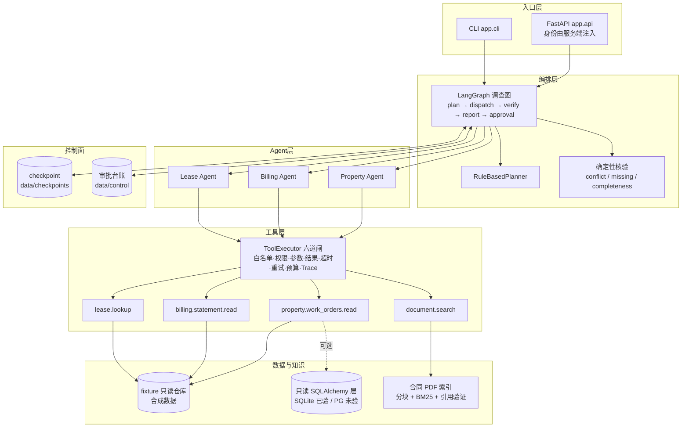

# commercial-property-multi-agent

商业地产租约与物业运营场景下的 **Agent-First 多 Agent 工作流**项目：
Runtime → 受控只读工具 → LangGraph 编排 → 合同条款证据 → 人工审批 → 评测 → 演示界面。

> **状态**：可运行、可演示、可解释的版本候选（release candidate）。
> 所有业务数据均为**合成数据**；未接真实 PostgreSQL、未调用真实模型（缺 API Key）。
> 未完成项在 [§8 已知限制](#8-已知限制不夸大) 中逐条列出，本文不夸大任何能力。

---

## 1. 这个项目在做什么

商业地产运营里，"租户投诉租金算错、要求减免"这类问题需要同时看**合同条款**、**账单与付款**、
**维修工单**，再走**两级审批**。LLM 单轮问答做不了这件事，因为它需要：

| 需求 | 本项目的做法 |
|---|---|
| 金额不能靠模型猜 | 全部由确定性工具用 `Decimal` 计算，模型只做陈述 |
| 结论要能回溯到原文 | 合同 PDF → 逐页条款分块 → 证据带**真实页码与条款号** |
| 不能越权看别家数据 | 权限/项目范围来自可信上下文，工具层强制过滤 |
| 该人工决定的不能自动化 | 审批是独立节点，批准只产出"已批准草案"，不写业务数据 |
| 说了要能验证 | 三基线评测 + 冻结评分规则 + 可复查报告 |

---

## 2. 快速开始

```bash
# 1) 环境（已建好，见 docs/prompts/01_environment/）
conda activate commercial-agent

# 2) 安装依赖（仅首次）
cd backend && python -m pip install -e .

# 3) 自检：工具清单 + Agent 配置一致性 + 契约自检
python -m app.cli tools
python -m app.cli check
python tests/smoke_agent_contracts.py

# 4) 跑一遍完整回归（192 项）
python -m unittest discover -s tests -p "test_*.py"
```

需要演示界面时：

```bash
python -m uvicorn app.api.app:app --host 127.0.0.1 --port 8000
# 打开 http://127.0.0.1:8000/
```

环境变量（全部可选，脚本与演示都能离线运行）：

| 变量 | 作用 | 缺省 |
|---|---|---|
| `DEEPSEEK_API_KEY` | 真实模型调用（`ask --provider deepseek`） | 未设置 → 只能用 Fake/离线 |
| `DEMO_PRINCIPAL_ID` | 演示 API 的可信主体 | `principal_ops_xinghui` |
| `DEMO_APPROVERS` | 演示 API 允许的审批人（逗号分隔） | 物业经理 + 财务 |
| `CONTRACT_PDF_OUT` / `DOC_OUT_DIR` | 合成 PDF 输出目录 | `docs/evaluation/documents/` |

模板见 [.env.example](.env.example)（**只有键名，无任何真实密钥**）。

---

## 3. 架构



**分层纪律**（有测试守着）：

- Coordinator **不 import 任何具体 Agent**，按 `capability` 从 Registry 解析；
- Agent **不 import 具体工具实现**，只认工具契约；
- 展示层只经 `WorkflowService`，`app.cli` / `app.evaluation` **不 import** `app.api`；
- 工具执行必须过六道闸，评测基线也不能绕过（否则评测在比生产更宽松的权限下跑）。

详细设计见：
[agent_architecture](docs/architecture/agent_architecture.md) ·
[database_design](docs/architecture/database_design.md) ·
[agent_runtime_contracts](docs/architecture/agent_runtime_contracts.md)。

---

## 4. 端到端演示（A-301 三个场景）

完整脚本（含期望输出与讲解词）见 [docs/demo/demo_script.md](docs/demo/demo_script.md)。

### 场景 A：确定性路径（不该惊动多 Agent）

```bash
python -m app.cli investigate "A-301 现在还有多少钱没交？" --lease lease_xh_a301_2025
```
→ `route=deterministic`，只走 billing，金额 `应收 52596.00 / 已收 34560.00 / 未收 18036.00`。

### 场景 B：跨系统冲突（必须扇出并且不擅自选边）

```bash
python -m app.cli investigate --lease lease_xh_a301_2025
```
→ `route=fanout`，三个子 Agent 并发，`verdict=conflicting`，冲突 `rent_variance=756.00`，
并列出缺失资料（附件B 未电子化）。

### 场景 C：需要人工审批（暂停 → 两人串行批准 → 只产出草案）

```bash
python -m app.cli investigate --with-approval --thread-id demo_thread
python -m app.cli pending
python -m app.cli approve <request_id> --principal principal_property_manager_xinghui --draft-version 2
python -m app.cli approve <request_id> --principal principal_finance_xinghui --draft-version 2
```
→ 第一次批准后仍是 `pending_next_stage`；第二次后 `approved`，返回
`approved_draft.status=approved_draft_only`、`executed_side_effects=[]`（**没有真实调账**）。

### 场景 D：证据可回溯

```bash
python -m app.cli search "租金递增比例" --verify-claim "自第二个租赁年度起租金递增百分之五"
```
→ 命中真实 PDF 第 12 页 5.2 条；`citation_check` 给出 L1（引用存在）与 L2（是否支持结论）。

---

## 5. 评测（三基线）

数据：8 道开发题（`cases/smoke_v1.jsonl`）+ 32 道保留题（`cases/heldout_v2.jsonl`，冻结后只跑不改）。
评分规则先冻结：[scoring_v1.md](docs/evaluation/scoring_v1.md)。

```bash
python -m app.cli evaluate --split heldout
```

保留集 v2（离线，`scoring-v1`，报告见 [docs/evaluation/reports/](docs/evaluation/reports/)）：

| 基线 | 架构 | 计分题通过 | 自动断言通过率 | 工具调用 | token | 成本 |
|---|---|---|---|---|---|---|
| `A_deterministic` | 意图表 → 单次工具 | 15/27 | 0.6481 | 27 | 0 | n/a（离线） |
| `B_single_agent` | 单 Agent 汇总全部工具 | 16/27 | 0.6975 | 38 | 0 | n/a（离线） |
| `C_multi_agent` | LangGraph 分解 + 核验 | 23/27 | 0.8704 | 47 | 0 | n/a（离线） |

**怎么读这张表**：

- 通过率只统计**可机械复核**的断言；人工量表（rubric）另列，不参与自动分；
- 路由命中只作**效率**指标（`B` 为 0/32 是架构使然，不是错误）；
- `C` 的领先来自"跨领域扇出 + 权限/审批边界"这类 A/B 结构上做不到的题；
  **单领域单工具的题上，A 一样对，且更省**；
- `token=0`、`cost=null` 是因为**没有调用真实模型**；不得把这些数字当作真实成本或质量。

---

## 6. 文档地图

| 位置 | 内容 |
|---|---|
| [docs/README.md](docs/README.md) | 文档规范、Prompt 全局编号表（001–015） |
| [docs/architecture/](docs/architecture/) | Agent 架构、接口契约、Runtime 契约、数据库设计 |
| [docs/prompts/](docs/prompts/) | 每个任务的完整存档（原始 Prompt + 实施 + 验证 + 问题） |
| [docs/development_logs/development_log.md](docs/development_logs/development_log.md) | 逐任务开发日志 |
| [docs/issues/issue_log.md](docs/issues/issue_log.md) | 问题、根因、修法、如何避免复发 |
| [docs/lessons_learned/knowledge_notes.md](docs/lessons_learned/knowledge_notes.md) | 技术原理与取舍（13 篇） |
| [docs/checkpoints/git_history.md](docs/checkpoints/git_history.md) | 里程碑与回滚参考 |
| [docs/evaluation/](docs/evaluation/) | 评测规则、数据集、报告 |
| [docs/demo/demo_script.md](docs/demo/demo_script.md) | 演示脚本与失败示例 |
| [backend/README.md](backend/README.md) | 工程细节、模块职责、命令清单 |

---

## 7. 质量证据

| 证据 | 命令 | 结果 |
|---|---|---|
| 契约自检 | `python tests/smoke_agent_contracts.py` | 57 项通过 |
| 单元/集成回归 | `python -m unittest discover -s tests -p "test_*.py"` | **192 项通过** |
| 冻结评测 | `python -m app.cli evaluate --split heldout` | 3 份 JSON + 汇总 Markdown |
| Agent 可禁用/替换 | `tests/test_graph_workflow.py::test_disabled_capability_degrades_explicitly`、`tests/test_runtime.py::test_replace_success_swaps_capabilities_atomically` | 禁用后明确报能力不可用；替换原子生效 |
| 审批只出草案 | `tests/test_approval.py`（21 项） | `approved_draft_only` + `executed_side_effects=[]` |
| 证据页码真实 | `tests/test_rag.py`（29 项） | fixture 声明页码 == 真实 PDF 页码 |
| 展示层可删除 | `tests/test_api.py::test_cli_and_evaluation_do_not_import_api` | 子进程断言通过 |

---

## 8. 已知限制（不夸大）

1. **未调用真实模型**：无 `DEEPSEEK_API_KEY`。真实工具调用闭环、真实 token/成本**未测量**。
2. **未接 PostgreSQL**：本机无服务，迁移与查询只在 SQLite 验证；`EXCLUDE` / RLS / 原生 `NUMERIC` 未实测。
3. **检索只有 BM25**：长问题召回不足（评测 H18–H20 已暴露）；向量/混合检索/rerank 属下一阶段。
4. **没有外部副作用实现**：调账/派单未实现，接入前必须先定义幂等键与补偿。
5. **演示鉴权是演示级**：服务端固定主体 + 审批人白名单，`X-Actor-Id` 不是认证。
6. **人工量表未评**：rubric 仍是待评队列，自动分不含表述质量。
7. **数据集有 5 题不可自动判定**（`cases_not_scored`），已在归档中记录，计划随 v3 修正。

---

## 9. 版本候选与后续

- 分支 `main`，当前提交见 `git log -1`；里程碑记录见 [git_history](docs/checkpoints/git_history.md)。
- **未打 Tag、未发布、未部署**——这些动作需要项目所有者确认。
- 建议的下一步（按价值排序）：
  1. 接真实 DeepSeek，按冻结配置重复 3 次测量质量/成本；
  2. 上 PostgreSQL 并实测排他约束与 RLS；
  3. 混合检索 + rerank，用评测集验证召回提升；
  4. 数据集 v3：补全无断言题；人工量表实际评分。
