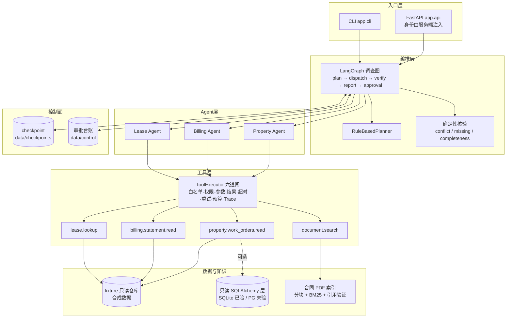

# commercial-property-multi-agent

商业地产租约与物业运营场景下的 **Agent-First 多 Agent 工作流**项目：
Runtime → 受控只读工具 → LangGraph 编排 → 合同条款证据 → 人工审批 → 评测 → 演示界面。

> **状态**：可运行、可演示、可解释的版本候选（release candidate）。
> 所有业务数据均为**合成数据**；未接真实 PostgreSQL、未调用真实模型（缺 API Key）。
> 未完成项在 [§8 已知限制](#8-已知限制不夸大) 中逐条列出，本文不夸大任何能力。

---

## 1. 这个项目在做什么

商业地产运营里，"租户投诉租金算错、要求减免"这类问题需要同时看**合同条款**、**账单与付款**、
**维修工单**，再走**两级审批**。LLM 单轮问答做不了这件事，因为它需要：

| 需求 | 本项目的做法 |
|---|---|
| 金额不能靠模型猜 | 全部由确定性工具用 `Decimal` 计算，模型只做陈述 |
| 结论要能回溯到原文 | 合同 PDF → 逐页条款分块 → 证据带**真实页码与条款号** |
| 不能越权看别家数据 | 权限/项目范围来自可信上下文，工具层强制过滤 |
| 该人工决定的不能自动化 | 审批是独立节点，批准只产出"已批准草案"，不写业务数据 |
| 说了要能验证 | 三基线评测 + 冻结评分规则 + 可复查报告 |

---

## 2. 快速开始

```bash
# 1) 环境（已建好，见 docs/prompts/01_environment/）
conda activate commercial-agent

# 2) 安装依赖（仅首次）
cd backend && python -m pip install -e .

# 3) 自检：工具清单 + Agent 配置一致性 + 契约自检
python -m app.cli tools
python -m app.cli check
python tests/smoke_agent_contracts.py

# 4) 跑一遍完整回归（345 项）
python -m unittest discover -s tests -p "test_*.py"
```

需要演示界面时：

```bash
python -m uvicorn app.api.app:app --host 127.0.0.1 --port 8000
# 打开 http://127.0.0.1:8000/
```

环境变量（全部可选，脚本与演示都能离线运行）：

| 变量 | 作用 | 缺省 |
|---|---|---|
| `DEEPSEEK_API_KEY` | 真实模型调用（`--model-provider deepseek`） | 未设置 → 只能用 Fake/离线 |
| `DEMO_PRINCIPAL_ID` | 演示 API 的可信主体 | `principal_ops_xinghui` |
| `DEMO_APPROVERS` | 演示 API 允许的审批人（逗号分隔） | 物业经理 + 财务 |
| `CONTRACT_PDF_OUT` / `DOC_OUT_DIR` | 合成 PDF 输出目录 | `docs/evaluation/documents/` |

**在哪里填 Key（两种方式，任选其一）**

1. **推荐：写进 `.env`（一次配置，CLI 与 API 都自动读取）**

```powershell
cd D:\commercial-property-multi-agent
Copy-Item .env.example .env      # 首次：生成 .env（已被 .gitignore 忽略）
notepad .env                     # 找到这一行，把值填在等号后面：
# DEEPSEEK_API_KEY=sk-你的真实密钥
```

2. **当前终端临时导出**（关掉终端即失效，适合单次验证）

```powershell
$env:DEEPSEEK_API_KEY = "sk-你的真实密钥"
```

填好之后这样验证（不会打印密钥本身）：

```powershell
cd backend
python -m app.cli investigate --model-provider deepseek
```

未配置或填错时**会明确报错**（`MissingApiKeyError` / 鉴权失败），不会静默退回离线结果。
`DEEPSEEK_API_KEY` 只从环境变量或 `.env` 读取，YAML / 代码 / 文档里都没有它的位置。

模板见 [.env.example](.env.example)（**只有键名，无任何真实密钥**）。
优先级：**已导出的环境变量优先**，`.env` 只补空缺。

---

## 3. 架构



**分层纪律**（有测试守着）：

- Coordinator **不 import 任何具体 Agent**，按 `capability` 从 Registry 解析；
- Agent **不 import 具体工具实现**，只认工具契约；
- 展示层只经 `WorkflowService`，`app.cli` / `app.evaluation` **不 import** `app.api`；
- 工具执行必须过六道闸，评测基线也不能绕过（否则评测在比生产更宽松的权限下跑）。

详细设计见：
[agent_architecture](docs/architecture/agent_architecture.md) ·
[database_design](docs/architecture/database_design.md) ·
[agent_runtime_contracts](docs/architecture/agent_runtime_contracts.md)。

---

## 4. 端到端演示（A-301 三个场景）

完整脚本（含期望输出与讲解词）见 [docs/demo/demo_script.md](docs/demo/demo_script.md)。

### 场景 A：确定性路径（不该惊动多 Agent）

```bash
python -m app.cli investigate "A-301 现在还有多少钱没交？" --lease lease_xh_a301_2025
```
→ `route=deterministic`，只走 billing，金额 `应收 52596.00 / 已收 34560.00 / 未收 18036.00`。

### 场景 B：跨系统冲突（必须扇出并且不擅自选边）

```bash
python -m app.cli investigate --lease lease_xh_a301_2025
```
→ `route=fanout`，三个子 Agent 并发，`verdict=conflicting`，冲突 `rent_variance=756.00`，
并列出缺失资料（附件B 未电子化）。

### 场景 C：需要人工审批（暂停 → 两人串行批准 → 只产出草案）

```bash
python -m app.cli investigate --with-approval --thread-id demo_thread_01
python -m app.cli pending
python -m app.cli approve <request_id> --principal principal_property_manager_xinghui --draft-version 2
python -m app.cli approve <request_id> --principal principal_finance_xinghui --draft-version 2
```
→ 第一次批准后仍是 `pending_next_stage`；第二次后 `approved`，返回
`approved_draft.status=approved_draft_only`、`executed_side_effects=[]`（**没有真实调账**）。

> 每条 `thread_id` 只能承载**一次**运行：重复用同一个 `--thread-id` 做新调查会被明确拒绝
> （`invalid_context`），因为持久化状态里的旧结果不能混进新结论。再演示一次请换
> `demo_thread_02`，或使用新的 `--control-dir`。

### 场景 D：证据可回溯

```bash
python -m app.cli search "租金递增比例" --verify-claim "自第二个租赁年度起租金递增百分之五"
```
→ 命中真实 PDF 第 12 页 5.2 条；`citation_check` 给出 L1（引用存在）与 L2（是否支持结论）。

---

## 5. 评测（三基线）

数据：8 道开发题（`cases/smoke_v1.jsonl`，为人工量表写的自然语言题）+ 32 道保留题
（`cases/heldout_v3.jsonl`，冻结后只跑不改；其中 H25/H26 显式声明为人工评定，30 题参与自动计分）。
评分规则先冻结：[scoring_v3.md](docs/evaluation/scoring_v3.md)（v1/v2 规则与历史报告保留在
[scoring_v1.md](docs/evaluation/scoring_v1.md)、[scoring_v2.md](docs/evaluation/scoring_v2.md)
与 reports 目录，**不同版本不可做通过率对比**）。

```bash
python -m app.cli evaluate --split heldout
```

保留集 v3（离线，`scoring-v3.1`，报告见 [docs/evaluation/reports/](docs/evaluation/reports/)）：

| 基线 | 架构 | 计分题通过 | 自动断言通过率 | 工具事实断言 | 最终答案断言 | 工具调用 | token | 成本 |
|---|---|---|---|---|---|---|---|---|
| `A_deterministic` | 意图表 → 单次工具 | 20/30 | 0.725 | 28/33 | 9/9 | 27 | 0 | n/a（离线） |
| `B_single_agent` | 单 Agent 汇总全部工具 | 21/30 | 0.7667 | 29/33 | 11/11 | 38 | 0 | n/a（离线） |
| `C_multi_agent` | LangGraph 分解 + 核验 | 23/30 | 0.8417 | 30/33 | 11/11 | 47 | 0 | n/a（离线） |

**怎么读这张表**：

- 通过率只统计**可机械复核**的断言；人工量表（rubric）与 `scorable=false` 的题另列，
  不参与自动分。断言必须是**同名字段**比较（金额用 `Decimal` 比到分），不允许"数字在文本里出现过"即通过；
- **"工具事实"与"最终答案"分开统计**（`scoring-v3`）：前者回答"取数对不对"，后者回答
  "用户读到的金额对不对"。答案里出现工具事实之外的金额判失败，只说"已核对"没写金额转人工，
  两者都不允许用对方的通过率背书；
- 基线事实契约之外、无法自动判定的断言进人工队列，**不进分母**——所以"0/0"表示"没有可判定的题"，
  与"0/7（全错）"不是一回事；
- 路由命中只作**效率**指标（`B` 为 0/32 是架构使然，不是错误）；
- `C` 的领先主要来自"跨领域扇出 + 权限/审批边界"这类 A/B 结构上做不到的题；
  **单领域单工具的题上，A 一样对，且更省**；
- 开发集（8 题）三基线都是 0/7：那批题是自然语言断言、面向人工量表，离线基线不解析自然语言，
  因此**不能**用它的通过率评价实现质量；
- `token=0`、`cost=null` 是因为**没有调用真实模型**；不得把这些数字当作真实成本或质量。

---

## 6. 文档地图

| 位置 | 内容 |
|---|---|
| [docs/README.md](docs/README.md) | 文档规范、Prompt 全局编号表（001–015） |
| [docs/architecture/](docs/architecture/) | Agent 架构、接口契约、Runtime 契约、数据库设计 |
| [docs/prompts/](docs/prompts/) | 每个任务的完整存档（原始 Prompt + 实施 + 验证 + 问题） |
| [docs/development_logs/development_log.md](docs/development_logs/development_log.md) | 逐任务开发日志 |
| [docs/issues/issue_log.md](docs/issues/issue_log.md) | 问题、根因、修法、如何避免复发 |
| [docs/lessons_learned/knowledge_notes.md](docs/lessons_learned/knowledge_notes.md) | 技术原理与取舍（29 篇） |
| [docs/checkpoints/git_history.md](docs/checkpoints/git_history.md) | 里程碑与回滚参考 |
| [docs/evaluation/](docs/evaluation/) | 评测规则、数据集、报告 |
| [docs/demo/demo_script.md](docs/demo/demo_script.md) | 演示脚本与失败示例 |
| [backend/README.md](backend/README.md) | 工程细节、模块职责、命令清单 |

---

## 7. 质量证据

| 证据 | 命令 | 结果 |
|---|---|---|
| 契约自检 | `python tests/smoke_agent_contracts.py` | 57 项通过 |
| 单元/集成回归 | `python -m unittest discover -s tests -p "test_*.py"` | **345 项通过**（1 项因本机已配置密钥而 skip） |
| 冻结评测 | `python -m app.cli evaluate --split heldout` | 3 份 JSON + 汇总 Markdown（绑定提交与校验和） |
| 模型预算按物理请求记账 | `tests/test_model_budget.py`（6 项） | `max_model_calls=1` 时只发出 1 次请求；重试/补查逐次记账 |
| 模型不能换目标/丢筛选 | `tests/test_task_scope.py`（15 项） | 越界租约被拒、省略即注入、文档范围取交集、受控调用双省略默认拒绝 |
| 零取证不算完成 | `tests/test_evidence_and_answer.py`（N4 部分） | 不调工具 / 调无关工具 / 工具全失败 → `insufficient_evidence` |
| 答案金额必须来自事实 | `tests/test_evidence_and_answer.py`（N6 部分） | facts 全对但回答写 0.00 → 答案断言失败；报告列出 `narrative_discrepancies` |
| 真实模型记账与叙述核验 | `docs/evaluation/reports/real_model_v2/`（30k token 上限、单题） | 物理请求 7 = 账本 7；13,714 tokens；修正后可核验答案为 `consistent` |
| SQLite + RAG 真实装配 | `python -m app.cli investigate --backend sqlite` | 退出码 0（含合同条款检索） |
| 审批意见落库 | `python -m app.cli approve <id> --draft-version N --reason "..."` → `pending` | 台账 `stages[].reason` 为提交的意见 |
| Agent 可禁用/替换 | `tests/test_graph_workflow.py::test_disabled_capability_degrades_explicitly`、`tests/test_runtime.py::test_replace_success_swaps_capabilities_atomically` | 禁用后明确报能力不可用；替换原子生效 |
| 审批只出草案 | `tests/test_approval.py`（26 项） | `approved_draft_only` + `executed_side_effects=[]`；终态重复提交受幂等保护 |
| 证据页码真实 | `tests/test_rag.py`（33 项） | fixture 声明页码 == 真实 PDF 页码；条款检索限定本租约文档 |
| 评分字段绑定 | `tests/test_evaluation.py::TestFactFieldBinding`（6 项） | 金额互换、错字段、差一分均判失败 |
| 主体隔离 | `tests/test_api.py::TestRunOwnership` | 跨项目读取按"不存在"处理（404） |
| 运行身份一致 | `tests/test_api.py::TestRunIdentity`（4 项） | 公开 `run_id` == checkpoint context == 审批 == 每条 trace |
| 持久线索不被复用 | `tests/test_approval.py::TestThreadIdentityBoundary`（5 项） | 跨主体/换租约/重复调查均被拒绝，越权主体拿不到他人旧结果 |
| 运行范围归属 | `tests/test_api.py::TestLegacyRunScope`、`TestReportScopeIsNotCreatorGrant` | 空范围默认拒绝；数据范围 ≠ 创建者授权范围 |
| 文档签署状态 | `tests/test_rag.py::TestDocumentStatusPolicy`（6 项） | 默认不返回未签署草案；草案显式单列 |
| 证据精确绑定 | `tests/test_rag.py::TestFindingEvidenceBinding`（3 项） | 同条号不同版本/5.1 与 5.1.1 各绑各的 chunk |
| 完成条件 | `tests/test_llm_tool_loop.py::TestInvalidModelResponses` | 调过工具但空回答 → `MODEL_ERROR` |
| 模型驱动装配 | `tests/test_llm_agents.py`（23 项） | 同一题在确定性/LLM 引擎下判定一致；事实取自工具；并发预算逐次记账 |
| 缺密钥不降级 | `python -m app.cli investigate --model-provider deepseek` | EXIT=2 + `MissingApiKeyError`（不静默退回离线） |
| `.env` 真实生效 | `tests/test_env.py`（15 项） | 填了就读取；环境变量优先；值不回显；`.env` 不入库 |
| 真实模型闭环（已实测） | `investigate --model-provider deepseek` | `conflicting` + 756.00；8 次模型调用 / 12 次工具 / 14,421 tokens |
| 真实模型评测（dev 8 题） | `evaluate --split dev --model-provider deepseek` | B 1/7、C 0/6；报告头部标注 `deepseek/deepseek-chat`（见 [real_model_dev](docs/evaluation/reports/real_model_dev/)） |
| 报告不得谎报模型 | `tests/test_evaluation.py::test_report_names_the_real_model_when_one_is_used` | 接入模型后报告必须写真实 provider |
| 展示层可删除 | `tests/test_api.py::test_cli_and_evaluation_do_not_import_api` | 子进程断言通过 |
| 独立环境复现 | 全新 `venv`（隔离已确认）→ `pip install -e .` → 全量测试 | 238 项测试 + 57 项契约通过，CLI 与 SQLite 后端 `EXIT=0`（Task 016 当时的口径；当前为 343 项） |
| 演示页可用 | 本地 `uvicorn` + 浏览器实访 | 运行/线程 ID、结论、证据、冲突、审批阶段与 Trace 均正确渲染 |

---

## 8. 已知限制（不夸大）

1. **真实模型已实测，但只在 dev 集**：`ask` / `investigate` / `evaluate --split dev` 均已真实调用
   DeepSeek（报告见 [real_model_dev](docs/evaluation/reports/real_model_dev/)）。**heldout 32 题的真实对照尚未执行**，
   且 dev 集是自然语言断言 + 人工量表题，其通过率**不能**用于 B vs C 的质量结论。
   成本金额未换算（项目未内置价格表）。
2. **未接 PostgreSQL**：本机无服务（`127.0.0.1:5432` 不可达），迁移与查询只在 SQLite 验证；
   `EXCLUDE` / RLS / 原生 `NUMERIC` 未实测。
3. **检索只有 BM25**：长问题召回不足（评测 H18–H20 已暴露）；向量/混合检索/rerank 属下一阶段。
4. **没有外部副作用实现**：调账/派单未实现，接入前必须先定义幂等键与补偿。
5. **演示鉴权是演示级**：服务端固定主体 + 审批人白名单，`X-Actor-Id` 不是认证。
6. **人工量表未评**：rubric 仍是待评队列，自动分不含表述质量；H25/H26 已显式声明为人工评定。
7. **开发集不是自动评测集**：8 道开发题为自然语言断言、面向人工量表，离线三基线在它上面都是 0/7，
   因此不能用它的通过率评价实现质量。
8. **失败路径只覆盖单机**：checkpoint 与审批台账是本机 SQLite，未验证多实例并发与分布式"恰好一次"。
9. **一条 `thread_id` 只能承载一次运行**：重复用它做新调查会被明确拒绝（`invalid_context`）；
   恢复请用 `resume`/`approve`，新任务请换线索。这是有意的安全约束，不是缺陷。

---

## 9. 版本候选与后续

- 分支 `main`，当前提交见 `git log -1`；里程碑记录见 [git_history](docs/checkpoints/git_history.md)。
- **未打 Tag、未发布、未部署**——这些动作需要项目所有者确认。
- 建议的下一步（按价值排序）：
  1. 真实模型 heldout 单基线（C）对照，另立报告版本（成本/时间可控时再跑全量）；
  2. 同题重复 3 次，测量延迟/token/答案稳定性；
  3. 若要给成本金额，先内置并冻结一张价格表；
  4. 上 PostgreSQL 并实测排他约束与 RLS（需实例）；
  5. 人工量表实际评分（H25/H26 与 rubric 队列）；
  6. 混合检索 + rerank，用评测集验证召回提升。
