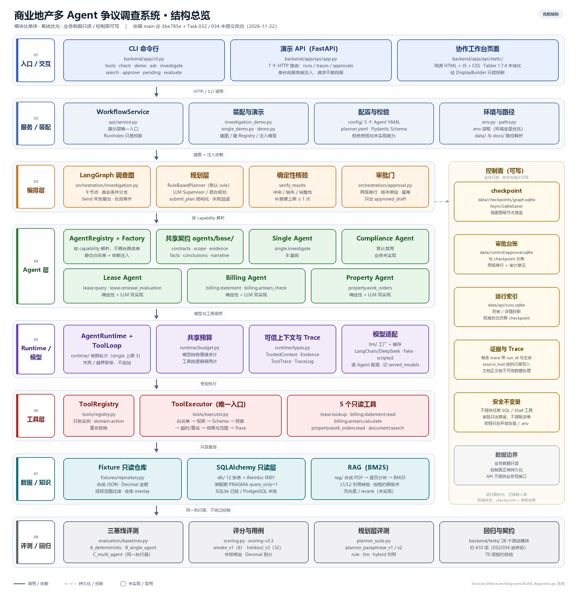
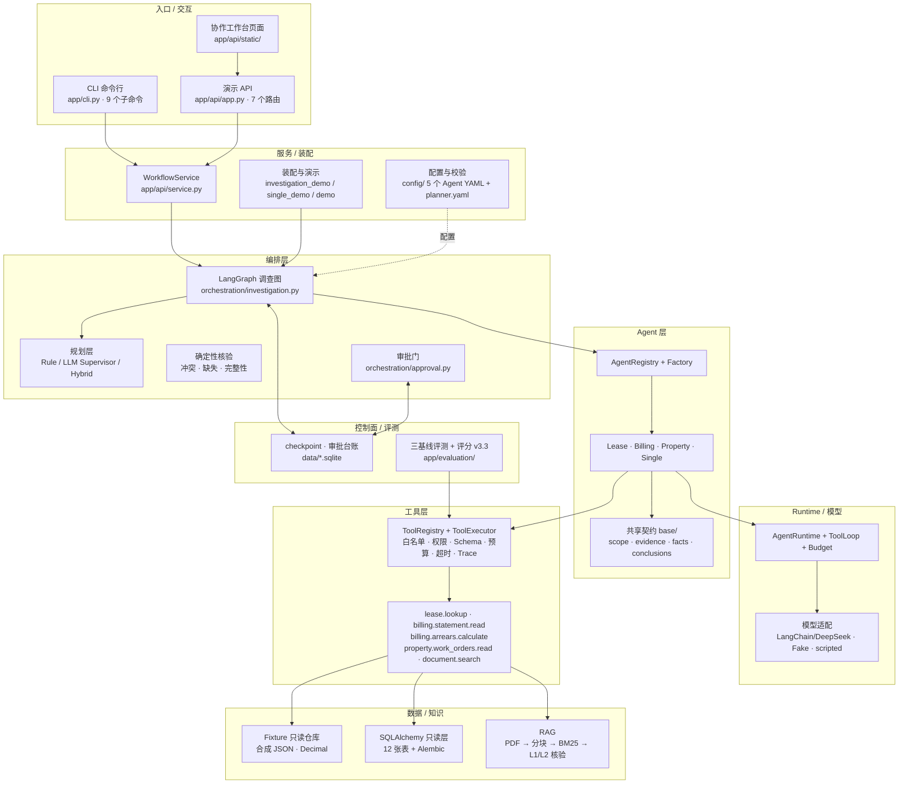
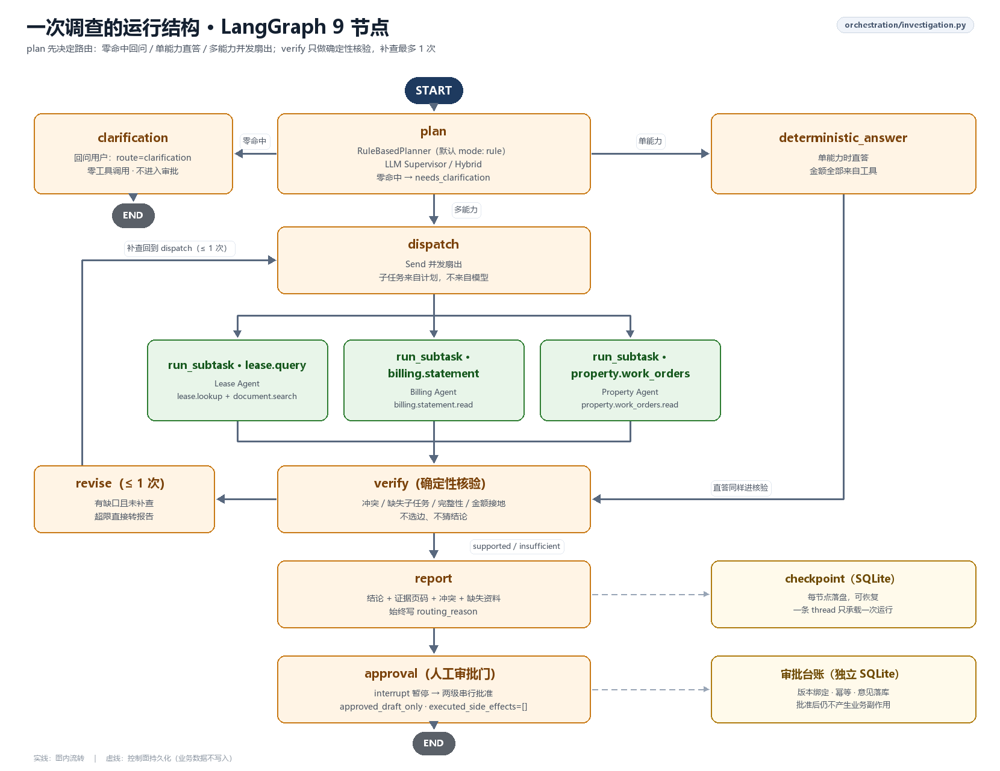
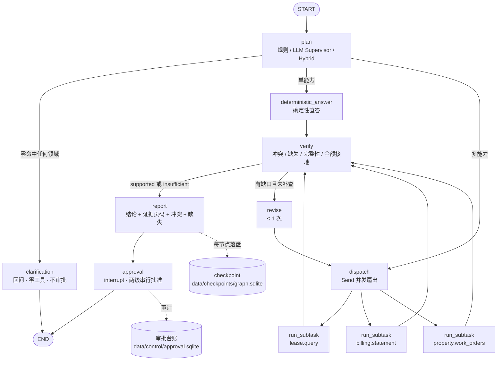
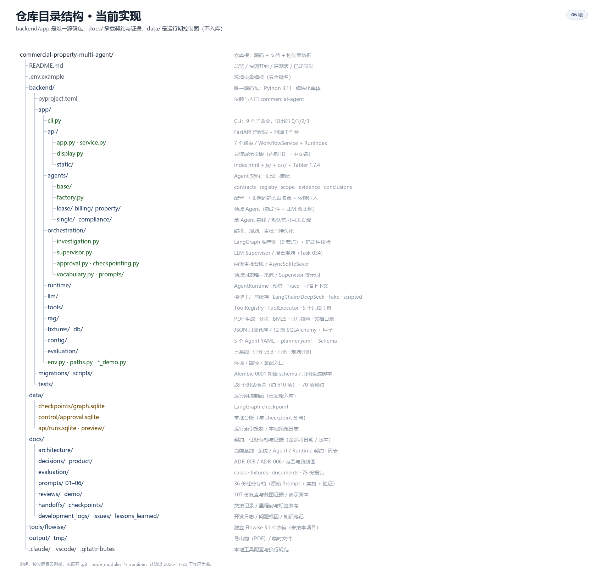

# 项目结构总览（架构图）

> **用途**：一页看懂"现在这个仓库里有什么、怎么串起来的"。
> **依据**：`main` @ `3be785e` + 工作区未提交的 Task 032 与 Task 034 改动（2026-11-22）。
> **核对方式**：直接读源码、配置、迁移与测试清单；没有在本机跑依赖 conda 环境的测试。
> **图**：三张 PNG 由 [`diagrams/build_diagrams.py`](diagrams/build_diagrams.py) 生成（Pillow 手绘，不依赖 graphviz / mermaid / 网络）。
> 权威状态与差距仍以 [当前基线](CURRENT_BASELINE.md) 为准，本页不新增结论。

## 0. 一句话

以**商业地产租金争议调查**为业务载体的**模块化单体**：CLI / FastAPI 两个入口 → 装配层 → LangGraph 编排（规则或 LLM Supervisor 规划）→ 领域 Agent → 受控只读工具 → 合成数据 / 合同 PDF → 确定性核验 → 人工审批门；业务数据只读，控制面（checkpoint / 审批台账）可写；评测走同一套执行器。

---

## 1. 系统分层总览





| 层 | 代码位置 | 这一层**必须**守住的约束 |
|---|---|---|
| 入口 / 交互 | `app/cli.py`、`app/api/`、`app/api/static/` | 身份由服务端注入；请求不能自报 `principal` / 权限 |
| 服务 / 装配 | `app/api/service.py`、`app/*_demo.py`、`app/config/` | 展示层只经 `WorkflowService`；YAML 拒绝密钥字段与未实现能力 |
| 编排 | `app/orchestration/` | 未命中领域必须回问，不静默落 billing；补查硬上限 1 次 |
| Agent | `app/agents/` | 按 capability 解析；不 import 具体工具实现 |
| Runtime / 模型 | `app/runtime/`、`app/llm/` | 预算按物理请求 / 逻辑调用分别记账；缺密钥明确报错，不静默降级 |
| 工具 | `app/tools/` | 所有调用过 `ToolExecutor`；评测基线也不能绕过 |
| 数据 / 知识 | `app/fixtures/`、`app/db/`、`app/rag/` | 业务数据只读；文档正文按不可信数据处理 |
| 控制面 / 评测 | `data/`、`app/evaluation/` | 控制面可写但不入库；报告必须写真实 provider |

---

## 2. 一次调查的运行结构





| 节点 | 作用 | 关键约束 |
|---|---|---|
| `plan` | 决定路由与子任务 | 规则默认零模型调用；`llm` / `hybrid` 由 Supervisor 只选领域，能力名与目标来自代码 |
| `clarification` | 未命中领域时回问 | `route=clarification`、零工具、不进入审批 |
| `dispatch` | 按计划扇出 | 子任务来自计划，不来自模型输出 |
| `run_subtask` | 单个能力执行 | 结果按 `subtask_id` 归并，重放不重复计数 |
| `deterministic_answer` | 单能力直答 | 金额由工具给出 |
| `verify` | 确定性核验 | 不选边、不猜结论；缺子任务即记 `MISSING_SUBTASK_RESULT` |
| `revise` | 限次补查 | `max_revisions = 1` |
| `report` | 汇总 | 必须写 `routing_reason`；失败调用不算取证 |
| `approval` | 人工审批门 | 只出 `approved_draft`，`executed_side_effects=[]` |

**路由三支**（`RuleBasedPlanner` 词表见 [planner_vocabulary](planner_vocabulary.md)）：零命中 → 澄清；命中单个领域且是纯确定性问法 → 直答；多个领域 → 扇出。

**规划层三种模式**（`app/config/planner.yaml`，默认 `rule`）：

| 模式 | 是否调用模型 | 行为 |
|---|---|---|
| `rule` | 否 | 词表规划，可复现、零成本；CLI / API / 评测默认 |
| `llm` | 是 | Supervisor 用唯一 `submit_plan` 工具输出计划；失败 / 超时 / 非法 / 超预算回退规则 |
| `hybrid` | 视情况 | 规则能确定就用规则，否则交 Supervisor；由确定性歧义信号判定 |

---

## 3. 仓库目录结构



```text
commercial-property-multi-agent/
├─ backend/                    唯一源码包（Python 3.11 · 模块化单体）
│  ├─ app/
│  │  ├─ cli.py                CLI：tools / check / demo / ask / investigate / search / approve / pending / evaluate
│  │  ├─ api/                  FastAPI 适配层 + 同源工作台（app.py · service.py · display.py · static/）
│  │  ├─ agents/               base/ 契约 + lease/ billing/ property/ single/ compliance/ + factory.py
│  │  ├─ orchestration/        investigation.py（调查图）· supervisor.py（规划）· approval.py · checkpointing.py
│  │  ├─ runtime/              AgentRuntime · tool_loop · budget · types（TrustedContext / Evidence / Trace）
│  │  ├─ llm/                  工厂与缓存 · LangChain/DeepSeek · Fake · scripted
│  │  ├─ tools/                Registry · Executor · 5 个只读工具
│  │  ├─ rag/                  PDF 生成 · 分块 · BM25 · 引用核验 · 文档目录
│  │  ├─ fixtures/  db/        JSON 只读仓库 / 12 表 SQLAlchemy + 种子
│  │  ├─ config/               5 个 Agent YAML + planner.yaml + Schema
│  │  └─ evaluation/           三基线 · scoring-v3.3 · 用例 · 规划评测
│  ├─ migrations/              Alembic 0001 初始 schema
│  └─ tests/                   28 个测试模块 + 70 项契约自检
├─ data/                       运行期控制面（已 .gitignore）
│  ├─ checkpoints/graph.sqlite LangGraph checkpoint
│  ├─ control/approval.sqlite  审批台账
│  └─ api/runs.sqlite          运行索引（投影）
├─ docs/                       契约、任务存档与证据
│  ├─ architecture/            当前基线 · 系统 / Agent / Runtime 契约 · 本页
│  ├─ decisions/  product/     ADR-005 / ADR-006 · 范围与路线图
│  ├─ evaluation/              cases · fixtures · documents · 75 份报告
│  ├─ prompts/ 01–06/          36 份任务存档（原始 Prompt + 实施 + 验证）
│  ├─ reviews/                 107 份复查与截图证据
│  └─ demo/ handoffs/ issues/ lessons_learned/ ...
├─ tools/flowise/              独立 Flowise 3.1.4 沙箱（未接本项目）
└─ output/  tmp/               导出物 / 临时文件
```

### `backend/app` 模块职责

| 模块 | 内容与职责 |
|---|---|
| `app/agents/base/` | `contracts`（AgentRequest/Output 等）、`registry`、`base_agent`、`tool_backed`、`llm_agent`、`scope`（`TaskScope` 可信目标）、`evidence`（成功且属于目标才算取证）、`facts`、`conclusions`（结构化资金结论）、`narrative`（叙述一致性）、`errors` |
| `app/agents/factory.py` | 配置 → 实例的**静态白名单**（确定性表 + LLM 表）、配置/实现一致性校验、按签名注入 |
| `app/agents/{lease,billing,property}/` | 领域 Agent：确定性实现 + `llm_agent.py`（模型选工具、事实取自工具输出）+ `prompts/system.md` |
| `app/agents/single/` | `single.investigate`：单 Agent + Tools 基线（B 基线） |
| `app/agents/compliance/` | `compliance.check`：**默认禁用**，业务未实现（调用返回 `NOT_IMPLEMENTED`） |
| `app/orchestration/investigation.py` | 实际 LangGraph 图（9 节点）、`InvestigationState`、`Planner` / `RuleBasedPlanner`、`verify_results`、报告与草案构造 |
| `app/orchestration/supervisor.py` | `LLMSupervisorPlanner`（`submit_plan` 结构化输出、目标剥离、回退）、`HybridPlanner`、`build_planner` |
| `app/orchestration/{approval,checkpointing}.py` | 两级串行审批 + 审计台账 + 幂等 / `AsyncSqliteSaver` 装配与 serde 白名单 |
| `app/orchestration/{state,coordinator}.py` | 早期通用 State 契约与协调器协议（调查图实际状态是 `investigation.InvestigationState`） |
| `app/runtime/` | `AgentRuntime`、有限轮次 `tool_loop`、共享 `Budget`、`TrustedContext` / `Evidence` / `ToolTrace` / `TraceLog` |
| `app/llm/` | 厂商无关消息类型、`Fake` / `scripted` 客户端、按配置建客户端并缓存、DeepSeek（OpenAI 兼容）适配 |
| `app/tools/` | `ToolRegistry`（只收实例）、`ToolExecutor`（唯一执行入口）、fixture 工具、`document.search` |
| `app/rag/` | `pdf_builder`（合成 PDF）、`chunker`（逐页条款）、`bm25`、`catalog`（按租约限版本）、`service`（L1/L2 引用核验） |
| `app/fixtures/` `app/db/` | 可替换只读仓库（Decimal、项目范围过滤、变体 overlay）/ SQLAlchemy 2.0 只读模型 + 种子 + 只读闸门 |
| `app/config/` | `schema`（Pydantic，拒绝密钥与未实现能力）、`loader`、5 个 Agent YAML、`planner.yaml` |
| `app/evaluation/` | `cases`、`baselines`（A/B/C）、`scoring`（字段绑定）、`runner`（报告与逐 Agent 模型）、`planner_suite`（规划层评测） |
| `app/api/` | FastAPI 适配层 + 同源工作台；**可整体删除**，CLI / 评测不依赖它 |
| `app/{env,paths}.py` | `.env` 读取（环境变量优先）、路径解析（以 `backend/` 为基准） |
| `app/{demo,investigation_demo,single_demo}.py` | 装配入口：建图、建 Registry、注入脚本化模型 |

---

## 4. 三条入口

### CLI（`python -m app.cli <命令>`）

| 命令 | 作用 |
|---|---|
| `tools` / `check` | 列出只读工具 / 校验 Agent、模型、检索配置与工具注册表 |
| `demo` / `ask` | 演示脚本 / 单 Agent 问答（必须带可信目标） |
| `investigate` | 多 Agent 调查（可选 `--with-approval`） |
| `search` | 合同条款检索（`--verify-claim` 做 L1/L2 核验） |
| `approve` / `pending` | 审批（`--dry-run` 只校验不写台账）/ 列出待审批 |
| `evaluate` | 三基线评测（`--split dev|heldout`、`--baseline`） |

退出码：`0` 成功（含 `partial`）、`1` 业务结果失败、`2` 用法/配置错误、`3` 审批错误。

### 演示 API（`uvicorn app.api.app:app`）

| 方法 | 路径 | 说明 |
|---|---|---|
| GET | `/` | 工作台页面（同源静态资源） |
| GET | `/api/meta` | 当前主体、审批人白名单与中文角色名 |
| POST / GET | `/api/runs` | 新建调查 / 案件列表 |
| GET | `/api/runs/{run_id}` | 报告与审批状态 |
| GET | `/api/runs/{run_id}/traces` | 逐次工具与模型调用 |
| POST | `/api/runs/{run_id}/approvals` | 审批动作（主体只能从服务端白名单选） |

### 评测（`python -m app.cli evaluate`）

`A_deterministic`（意图表 → 单次工具）/ `B_single_agent`（单 Agent 汇总全部工具）/ `C_multi_agent`（LangGraph 分解 + 核验）；评分规则 `scoring-v3.3` 分别判定**工具事实、资金结论、金额接地**。

规划层另有独立套件：`evaluate --suite planner`（对比 `rule` / `llm` / `hybrid`，用例 `planner_paraphrase_v1/v2`）；三基线也可用 `--planner llm|hybrid` 只跑 C 做对照。

---

## 5. 数据与控制面

| 位置 | 内容 | 谁写 |
|---|---|---|
| `docs/evaluation/fixtures/agent_first_v1.json` | 合成业务数据（12 类记录 + 审批/场景元数据，只读） | 手工维护 |
| `docs/evaluation/documents/*.pdf` | 合成合同 / 制度 PDF（索引内容可复现） | `app/rag/pdf_builder.py` 生成后入库 |
| `data/business/business.sqlite` | 只读业务副本（SQLite，可选） | `app/db/seed.py` 建库；装配期 `PRAGMA query_only=1` |
| `data/checkpoints/graph.sqlite` | LangGraph checkpoint | 调查图每个节点 |
| `data/control/approval.sqlite` | 审批请求 / 决策 / 幂等台账 | `approve` 与 API 审批 |
| `data/api/runs.sqlite` | 运行索引（列表/详情投影，非权威） | `WorkflowService` |

**边界**：业务数据只读；checkpoint 与审批台账会正常持久化（不能把"业务只读"说成"整个程序不写磁盘"）。安全不变量：不提供任意 SQL / Shell / 文件 / 网络工具；`Evidence.source_tool` 由执行器写入；文档正文按不可信数据；审批只出草案。

---

## 6. 分层纪律（有测试守着）

| 规则 | 守护位置 |
|---|---|
| Coordinator 只 import `agents/base`，具体 Agent 由 Registry 按 capability 解析 | `tests/test_graph_workflow.py::test_disabled_capability_degrades_explicitly`；`investigation.py` 的 import 清单 |
| Agent 不 import 具体工具实现，只认工具契约 | `tests/smoke_agent_contracts.py`（70 项） |
| 展示层只经 `WorkflowService`；CLI / 评测不 import `app.api` | `tests/test_api.py::test_cli_and_evaluation_do_not_import_api` |
| 工具调用必须过 `ToolExecutor`；受控调用不能省略目标，预算按逻辑调用记账 | `tests/test_task_scope.py`、`tests/test_model_budget.py` |
| Runtime 模块不 import 网络 / DB 依赖 | `tests/test_runtime.py::test_no_network_or_db_imports_in_runtime_modules` |
| 金额只用 `Decimal` / 工具，答案金额必须有事实来源 | `tests/test_fund_conclusions.py`、`tests/test_evidence_and_answer.py` |
| 审批只产出 `approved_draft`，无副作用 | `tests/test_approval.py` |
| 证据页码真实、只限本租约文档 | `tests/test_rag.py` |
| 一条 `thread_id` 只承载一次运行 | `tests/test_approval.py::TestThreadIdentityBoundary` |

---

## 7. 当前状态（不夸大）

- **代码状态**：Task 032（业务流程工作台 + U3 收尾）与 Task 034（LLM Supervisor / 混合规划）已提交为 `e1d0d2e`（未推送）；独立复查为有条件通过，返修经确认复查条件已满足，**不等于最终验收**。
- **测试口径**：[当前基线](CURRENT_BASELINE.md) 记录 Task 032 / 034 复查返修后 **610 项**测试（skipped=1）+ 70 项契约（2026-11-22）；Task 032 后为 606 项，Task 034 后为 595 项，Task 031 返修后为 551 项。
- **默认行为**：规划器 `mode: rule`；CLI 单 Agent `ask` 默认脚本化模型；网页 `WorkflowService` 仍为确定性演示（`model_client=None`、`max_model_calls=0`），**网页没有接模型**。
- **未完成 / 未验证**：PostgreSQL 实机（迁移与查询只在 SQLite 验证）、向量 / rerank 检索（只有 BM25）、外部业务副作用（调账 / 派单未实现）、正式真实 heldout 对照与重复测量、人工量表、独立环境复现、多实例并发语义。
- **版本**：未打 Tag、未发布、未部署。

---

## 8. 重新生成图

```bash
# 需要 Pillow 与中文字体（默认 C:\Windows\Fonts\msyh.ttc）
python docs/architecture/diagrams/build_diagrams.py            # 三张全部重绘
python docs/architecture/diagrams/build_diagrams.py overview   # 只重绘总览
```

图里的文字与层高由脚本内的 `BANDS` / `TREE` 列表驱动；改动结构后同步改这里，并顺手更新本页表格。
