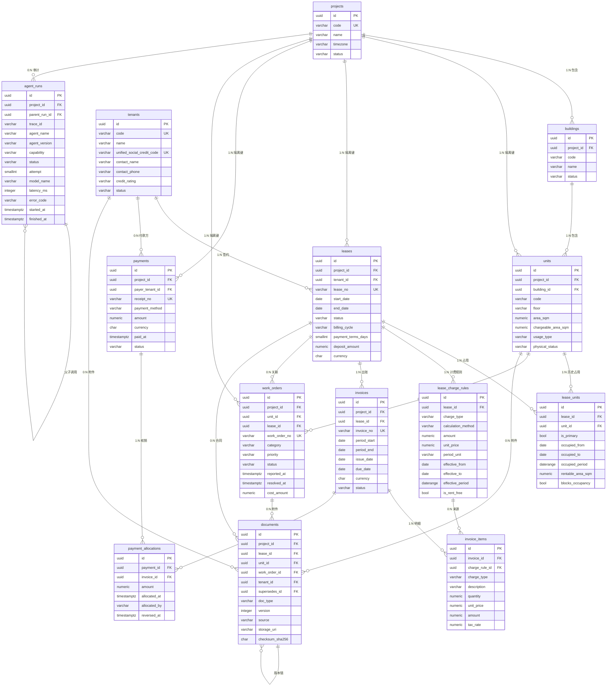

# 数据库设计

> **状态**：长期 14 表设计参考 · v2 复核修正；非当前 P0 全量建表要求
> **版本**：v2（2026-11-03 复核）— v1 存在 4 处会导致约束失效或语义错误的缺陷，已在 §15 修正
> **最后更新**：2026-11-03
> **关联任务**：004（用户侧编号「Task 003 — PostgreSQL 数据库架构设计」）
> **配套文档**：[system_design.md](./system_design.md)、[agent_architecture.md](./agent_architecture.md)
> **2026-11-09 适用范围修正（Task 026）**：方向以 [Agent-first V1.0](../handoffs/PROJECT_REFOCUS_AGENT_FIRST_V1.0.md)、[ADR-005](../decisions/ADR-005-agent-first-refocus.md) 和 [当前基线](CURRENT_BASELINE.md) 为准。下文设计正文保留；其中“MVP”“必须落地”等措辞仅适用于该长期模型，不能恢复完整 ERP 范围或覆盖当前精简实施。
> **实现边界**：当前已有 12 表 SQLAlchemy/Alembic 精简实现及 SQLite 验证；PostgreSQL 尚无实机验收。本文未证明 EXCLUDE/RLS 等已实现；旧“未建任何表”仅是 2026-11-03 的阶段状态。当前映射见 `backend/app/db/models.py`，与本文的差异见 [系统架构](system_design.md) §4，后续按 P0 必要性评审，不机械补齐 14 表。

---

## 1. 文档目的与范围

记录 `commercial-property-multi-agent` 的数据模型：实体、字段、关系、索引与约束，以及关键设计取舍的原因。本文件回答三个问题：

1. 数据怎么组织（表、字段、关系）。
2. 为什么这样组织（取舍理由与被否决的方案）。
3. Agent 怎么合规地访问这些数据（Service / Repository 边界）。

### 1.1 本次范围

| 包含 | 不包含 |
|---|---|
| 14 张表的逻辑设计、约束、索引 | 安装 PostgreSQL / 创建真实数据库 |
| 完整字段定义（类型 / Nullable / 默认值） | SQLAlchemy 模型代码 |
| ER 图与业务关系说明 | Alembic 迁移脚本 |
| 租金计算与核销的数据流 | 种子数据 / 性能压测 |
| Agent 通过 Service 访问的边界设计 | RLS 策略的实际启用 |

### 1.2 规模基线

第一阶段约 **30 个商铺、25 个租户、单个商业综合体**（`projects` 实际只有 1 行，但模型支持多项目）。

这个规模下的判断标准：**正确性与可维护性优先于查询性能**。但结构必须在数据量增长 10 倍、业务范围扩展到多项目时**不需要重新建模**。所有"为了性能而冗余"的设计在此规模下都不成立，因此本文档显著偏向规范化。

---

## 2. 设计原则

> 本节在任务 002 确立的 5 条原则基础上扩充。原 2.1「显式存储币种」保留并落地到 `invoices` / `payments` / `leases`。

### 2.1 金额与日期

- **金额**：一律 `NUMERIC(14,2)`（SQLAlchemy `Numeric(14, 2)`），**禁止浮点类型**。租金、账单、押金参与累加与核销，浮点误差在财务场景不可接受。
- **单价**：`NUMERIC(12,4)`。按面积计价时（元/㎡/月）需要比总额更高的精度，否则 30㎡ × 123.4567 会在源头就失真。
- **面积**：`NUMERIC(10,2)`。
- **货币**：`CHAR(3) NOT NULL DEFAULT 'CNY'`，加 `CHECK (currency ~ '^[A-Z]{3}$')`。MVP 单币种，但字段先立住，避免后续改表。
- **业务日期用 `DATE`**：租期、计费周期、到期日。这些是"日历上的某一天"，与时区无关。
- **系统时间戳用 `TIMESTAMPTZ`**：`created_at` / `updated_at` / `paid_at` / `reported_at`。这些是"某一刻发生的事件"，必须带时区。
- **两者不混用**。`invoices.due_date` 是 `DATE`（业务上"该月 10 号前付"），不是 `TIMESTAMPTZ`（不是"10 号 00:00:00 那一刻"）。

### 2.2 字符编码

数据库创建时 `ENCODING 'UTF8'`，`LC_COLLATE` 用 `C` 或业务需要的排序规则。中文名称（楼宇名、企业名、联系人）是核心数据，不能依赖系统默认编码。

### 2.3 主键策略

统一 `UUID PRIMARY KEY DEFAULT gen_random_uuid()`（PG 13+ 原生，无需 pgcrypto）。

理由：

- 业务编号会变（续签、合并、系统迁移），不能做外键。
- UUID 让前端可在提交前预生成 ID，便于 Agent 在多步任务中引用尚未落库的实体。
- 64 位自增在分库时会成为约束，UUID 不会。

代价：索引体积略大于 bigint。在当前规模可忽略。

业务编号（`lease_no` / `invoice_no` / `receipt_no`）作为 **UNIQUE 约束**，并**按项目维度唯一**（`UNIQUE(project_id, invoice_no)`），而不是全局唯一——不同综合体各自编号是常态。

### 2.4 软删除与历史

- 业务主数据（`projects` / `buildings` / `units` / `tenants` / `leases` / `invoices` / `payments` / `work_orders` / `documents`）带 `deleted_at TIMESTAMPTZ NULL`，**不做物理删除**。
- 明细与关联表（`lease_units` / `lease_charge_rules` / `invoice_items` / `payment_allocations` / `agent_runs`）**不做软删除**，随主表或走显式冲销（`payments.status='reversed'`）。
- **软删除与唯一约束冲突**：`UNIQUE(project_id, lease_no)` 会因软删除记录长期占用编号，导致同一编号无法重建。因此所有业务唯一约束都实现为**部分唯一索引**：

```sql
CREATE UNIQUE INDEX uq_leases_project_lease_no
    ON leases (project_id, lease_no)
    WHERE deleted_at IS NULL;
```

### 2.5 迁移管理

使用 Alembic 管理 schema 变更，所有变更通过迁移脚本，禁止手改数据库。迁移脚本纳入 Git。

**约束类变更的特别说明**：以下内容 Alembic autogenerate **无法生成**，必须手写 `op.execute()`，且要在评审清单中单独确认：

| 类型 | 原因 |
|---|---|
| `EXCLUDE` 约束（租期冲突） | SQLAlchemy/Alembic 不识别 |
| 部分唯一索引的 `WHERE` | 需 `postgresql_where`，autogenerate 易漏 |
| 复合外键（`(unit_id, project_id)` 形式） | 需显式 `ForeignKeyConstraint` |
| `CHECK` 中的表达式（`num_nonnulls` 等） | 需手写 |

### 2.6 枚举值的表示

**不使用 PostgreSQL 原生 `ENUM` 类型**，一律用 `TEXT NOT NULL` + `CHECK (col IN (...))`。

理由：

- 原生 enum 追加值需要 `ALTER TYPE ... ADD VALUE`，在事务里有限制；删除/重命名值几乎不可行，必须重建类型并改写所有依赖列。
- 本项目的状态机在早期会频繁调整（如账单状态、工单分类），原生 enum 会把简单迁移变成高风险操作。
- `TEXT + CHECK` 的迁移就是一条 `DROP CONSTRAINT` + `ADD CONSTRAINT`，安全且可回滚。

代价：没有类型层面的复用。通过统一在 `app/db/enums.py` 维护常量集中解决。

### 2.7 数据隔离键

`projects` 是数据隔离单元。为避免 RLS 与权限过滤时做 4 层 JOIN（`invoices → leases → lease_units → units → buildings → projects`），在叶子业务表上**冗余 `project_id`**。

冗余会带来不一致风险，因此用**复合外键**保证：

```sql
-- 父表声明可被引用的组合
ALTER TABLE units ADD CONSTRAINT uq_units_id_project UNIQUE (id, project_id);

-- 子表用复合外键锁定项目归属
ALTER TABLE leases
  ADD CONSTRAINT fk_leases_unit_project
  FOREIGN KEY (unit_id, project_id) REFERENCES units (id, project_id);
```

这样"租约的项目"与"商铺的项目"在数据库层面**不可能不一致**，冗余从"靠自觉维护"变成"由约束强制"。这是本文档中唯一的有意反规范化，且被约束兜住。

### 2.8 不存储可算出的数据

明确**不落库**的派生值（避免双写不一致）：

| 派生值 | 计算方式 |
|---|---|
| 账单总额 `invoice_total` | `SUM(invoice_items.amount)` |
| 已核销额 `paid_amount` | `SUM(payment_allocations.amount)`（仅 `payments.status='confirmed'`） |
| 未收余额 `balance` | 总额 − 已核销额 |
| 账单"已付/部分付"状态 | 由 balance 与总额比较得出 |
| 逾期状态 `is_overdue` | `due_date < CURRENT_DATE AND balance > 0` |
| 租约"已到期" | `end_date < CURRENT_DATE AND status = 'active'` |
| 收款"已核销完" | `SUM(allocations) = payments.amount` |

统一由视图 `v_invoice_outstanding` 与 Service 层暴露，**不写回表**。

### 2.9 区间一律物化，禁止用 NULL 表示"开放式区间"

**v1 的错误**：v1 曾定义 `lease_units.occupied_to = NULL` 表示"至租约结束"，这与排他约束的语义直接冲突——约束只能看到列值，`NULL` 会被 `COALESCE(...,'infinity')` 解释为**无限期占用**，导致该商铺被永久锁死，后续任何租约都无法录入。

**v2 规则**：

1. 所有参与约束的区间端点**必须 `NOT NULL`**，创建时由触发器从来源字段物化。
2. 区间用**半开** `[from, to)`，避免"上份 12-31 结束、下份 12-31 开始"被判为重叠。
3. 区间范围列用 **`GENERATED ALWAYS AS (...) STORED`** 生成列，而不是在 `EXCLUDE` 里写表达式。原因：生成列是确定的普通列，索引与约束行为无歧义；同时避免"表达式是否可安全用于索引"的不确定性。
4. 业务上确实需要"开放式"时，由触发器写入一个**具体日期**（如租约结束日），而不是 `NULL`。

---

## 3. 对初始 13 张表方案的评估

> 结论：**初始 13 张表的方向正确，没有需要删除的表，也没有需要合并的冗余表。但缺少 1 张关键关联表，并存在 9 处需要补充的设计细节。** 建议最终采用 **14 张表**。

### 3.1 保留判断（不需要合并或删除）

| 表 | 判断 | 理由 |
|---|---|---|
| `invoice_items` vs `invoices` | **必须分开** | 一张账单含多个收费科目（租金/物业费/能耗费/调整），合并会导致重复行或 JSON 字段，两者都会让"按科目汇总"变得不可靠 |
| `payment_allocations` | **必须独立** | 用户明确要求"一笔付款核销多张账单"，这是多对多且带金额与时间的关联实体，不是简单外键 |
| `lease_charge_rules` | **必须独立** | 阶梯租金、免租期、物业费都是"随时间分段的规则"，塞进 `leases` 会让租约表字段爆炸且无法表达多段 |
| `documents` | **保留** | 合同版本与来源追溯需要独立表，且要能挂到租约/工单/商铺多个主体 |
| `agent_runs` | **保留** | 与任务 003 的 `AgentResult` 契约一一对应，是审计与成本归集的基础 |

### 3.2 发现的 9 个问题

| # | 问题 | 影响 | 处理 |
|---|---|---|---|
| 1 | **缺少 `lease_units` 关联表** | 若把 `unit_id` 直接放 `leases`，"未来支持多商铺租约"将需要**破坏性迁移 + 全量代码改动**（所有查询都要改） | **新增 `lease_units`**（第 14 张表）。MVP 用 `UNIQUE(lease_id)` 限制一租约一商铺，放开只需删一个索引 |
| 2 | 租约占用时间冲突无法用普通约束表达 | "同一商铺合同时间不得冲突"用应用层校验在并发下会失效 | 用 PostgreSQL **`EXCLUDE USING gist`** 排他约束（需 `btree_gist`） |
| 3 | 排他约束不能引用其他表的状态 | 草稿租约不应占用商铺，但 EXCLUDE 无法 JOIN `leases.status` | 在 `lease_units` 上加本地布尔列 `blocks_occupancy`，由触发器同步。这是为满足 PG 约束能力而做的受控冗余 |
| 4 | 缺少"收费规则 → 账单明细"的追溯链 | 账单金额无法回溯到是哪条规则算出来的，审计无法回答"为什么收这个数" | `invoice_items.charge_rule_id` 可空外键 |
| 5 | `documents` 缺少版本与来源字段 | 用户明确要求"合同文档支持版本及来源追溯"，仅靠 `created_at` 无法还原 | 增加 `version` / `supersedes_id` / `source` / `checksum_sha256` |
| 6 | 缺少项目隔离键 | 未来启用 RLS 时，账单需要 4 层 JOIN 才能定位项目，策略无法高效表达 | 叶子表冗余 `project_id` + 复合外键锁定（见 2.7） |
| 7 | `agent_runs` 缺少 `trace_id` / `parent_run_id` | 无法还原 Coordinator → 子 Agent 的调用树，也无法与日志串联 | 补齐这两个字段 |
| 8 | 软删除与业务编号唯一约束冲突 | 编号被软删除记录永久占用 | 一律用部分唯一索引（见 2.4） |
| 9 | 用户提到"商铺维修与物业工单"关联商铺，但公共区域工单无商铺 | 若 `unit_id NOT NULL`，大堂/电梯/外墙工单无法录入 | `unit_id` 可空 + `CHECK` 要求在无商铺时必须填 `location_note` |

### 3.3 明确不建的表（避免无意义膨胀）

| 候选表 | 为什么不建 |
|---|---|
| `billing_periods`（计费周期中间表） | MVP 为按月/季规律计费，`invoices.period_start/period_end` 两列已足够。引入中间层会让"补收""调账"变复杂，而这些场景暂未出现 |
| `document_chunks` | 向量与切片属于 RAG 阶段（阶段 3），存 Chroma，不落 PostgreSQL。需先把 chunk→document 的引用关系定下来再建 |
| `invoice_status_history` | 财务状态历史有价值，但 MVP 只有 `draft→issued→void` 三步且不可逆；`void_reason` + `updated_at` 已够追溯。列为阶段 5 候选 |
| `tenant_contacts` | 25 个租户、多为 1 个主联系人。先用 `tenants.contact_*` 三列，出现多联系人需求再拆 |
| `staff_users` | 工单受理人当前用 `assigned_to TEXT`。人员与权限体系属于阶段 5，此时建表会与未来的认证方案冲突 |
| `conversations` / `messages` | Agent 会话是否持久化仍是 `system_design.md` 待定问题 #3。消息表依赖 State 设计，现在建大概率要重构 |

---

## 4. 最终表清单（14 张）

### 4.1 分层

| 层 | 表 | 说明 |
|---|---|---|
| **组织层** | `projects` → `buildings` → `units` | 项目的物理空间结构，三层固定，楼层作为 `units.floor` 属性而非独立表 |
| **主体层** | `tenants` | 租户（企业法人/个体），全局共享，不带 `project_id` |
| **合约层** | `leases`、`lease_units`、`lease_charge_rules` | 租约主体 + 空间占用 + 计费规则 |
| **账务层** | `invoices`、`invoice_items`、`payments`、`payment_allocations` | 应收、明细、实收、核销 |
| **运营层** | `work_orders` | 报修与物业工单 |
| **知识层** | `documents` | 合同与附件的元数据、版本、来源 |
| **可观测层** | `agent_runs` | Agent 执行审计、成本与追踪 |

### 4.2 表与初始方案的对应

| # | 最终表名 | 来源 | 说明 |
|---|---|---|---|
| 1 | `projects` | 初始方案 | 商业综合体/项目 |
| 2 | `buildings` | 初始方案 | 楼栋 |
| 3 | `units` | 初始方案 | 商铺/单元 |
| 4 | `tenants` | 初始方案 | 租户 |
| 5 | `leases` | 初始方案 | 租约（不含 `unit_id`，见问题 1） |
| 6 | `lease_units` | **新增** | 租约 × 商铺占用，含排他约束 |
| 7 | `lease_charge_rules` | 初始方案 | 分段计费规则 |
| 8 | `invoices` | 初始方案 | 应收账单（不含总额，见 2.8） |
| 9 | `invoice_items` | 初始方案 | 账单明细 |
| 10 | `payments` | 初始方案 | 实收记录 |
| 11 | `payment_allocations` | 初始方案 | 付款核销 |
| 12 | `work_orders` | 初始方案 | 维修/物业工单 |
| 13 | `documents` | 初始方案 | 文档元数据与版本 |
| 14 | `agent_runs` | 初始方案 | Agent 运行审计 |

**13 → 14：仅新增 `lease_units`，无删除、无合并。**

---

## 5. 核心业务实体说明

| 实体 | 业务含义 | 关键不变量 |
|---|---|---|
| **项目 `projects`** | 一个商业综合体，是数据隔离与权限的最小单元 | 业务编码全局唯一 |
| **楼栋 `buildings`** | 项目内的独立建筑 | 同一项目内编码唯一；必须属于一个项目 |
| **商铺 `units`** | 可出租的最小空间单元（铺位） | 同一楼栋内铺号唯一；面积必须 > 0；项目归属必须与所属楼栋一致 |
| **租户 `tenants`** | 签约主体（企业/个人） | 统一社会信用代码全局唯一（可空）；不随项目隔离 |
| **租约 `leases`** | 一份租赁合同，锁定租户与租期 | `end_date > start_date`；一个租约只对应一个租户；租户变更必须新签租约，**不得改既有租约** |
| **租约占用 `lease_units`** | 租约对某个商铺在某个区间的占用权 | 同一商铺的占用区间**不得重叠**（排他约束）；MVP 下一租约仅一行 |
| **计费规则 `lease_charge_rules`** | 在某个时间段内，某类费用如何计算 | 同一租约同一 `charge_type` 的生效区间不得重叠；免租期金额必须为 0 |
| **账单 `invoices`** | 向租户开具的一期应收 | 一个账单只属于一个租约；账单周期不得与同租约同类型账单重叠（服务层校验） |
| **账单明细 `invoice_items`** | 账单中的一行收费 | 金额与数量必须自洽；可回溯到计费规则 |
| **收款 `payments`** | 实际收到的一笔钱 | 金额 > 0；冲销后不得再核销新账单 |
| **核销 `payment_allocations`** | 一笔收款冲抵一张账单的金额 | `Σ核销 ≤ 收款金额`；`Σ核销 ≤ 账单总额`（服务层事务内校验） |
| **工单 `work_orders`** | 一次报修或物业作业 | 关闭前必须有 `resolved_at`；无商铺时必须填位置说明 |
| **文档 `documents`** | 合同/附件/照片的元数据 | 版本号在同一文档链内唯一；`checksum` 用于识别重复上传 |
| **Agent 运行 `agent_runs`** | 一次 Agent 调用的审计记录 | 与任务 003 的 `AgentResult` 字段一一对应；终态后不可修改 |

---

## 6. 表结构详解

### 6.0 标准列约定

以下列在所有表上含义一致，后文不再重复解释：

| 列 | 类型 | Nullable | 默认 | 说明 |
|---|---|---|---|---|
| `id` | `uuid` | NO | `gen_random_uuid()` | 主键 |
| `created_at` | `timestamptz` | NO | `now()` | 记录创建时刻（系统时间） |
| `updated_at` | `timestamptz` | NO | `now()` | 最后修改时刻，由触发器 `set_updated_at()` 维护 |
| `deleted_at` | `timestamptz` | YES | `NULL` | 软删除标记；仅主数据表有 |

- 主数据表（带软删除）：`projects`、`buildings`、`units`、`tenants`、`leases`、`invoices`、`payments`、`work_orders`、`documents`。
- 明细/关联表（无软删除）：`lease_units`、`lease_charge_rules`、`invoice_items`、`payment_allocations`、`agent_runs`。

### 6.1 `projects` — 商业综合体

| 字段 | 类型 | Nullable | 默认 | 说明 |
|---|---|---|---|---|
| `code` | `varchar(32)` | NO | — | 项目编码，业务唯一 |
| `name` | `varchar(128)` | NO | — | 项目名称 |
| `city` | `varchar(64)` | YES | `NULL` | 所在城市 |
| `address` | `varchar(255)` | YES | `NULL` | 详细地址 |
| `timezone` | `varchar(64)` | NO | `'Asia/Shanghai'` | 业务日期计算基准（跨时区项目避免误算账期） |
| `status` | `varchar(16)` | NO | `'active'` | `active` / `inactive` / `archived` |

**约束**：`PRIMARY KEY (id)`；部分唯一索引 `(code) WHERE deleted_at IS NULL`。

### 6.2 `buildings` — 楼栋

| 字段 | 类型 | Nullable | 默认 | 说明 |
|---|---|---|---|---|
| `project_id` | `uuid` | NO | — | FK → `projects(id)`，`ON DELETE RESTRICT` |
| `code` | `varchar(32)` | NO | — | 楼栋编号（如 `A`、`T2`） |
| `name` | `varchar(128)` | NO | — | 楼栋名称 |
| `floors_above_ground` | `smallint` | YES | `NULL` | 地上层数，`CHECK >= 0` |
| `gross_floor_area` | `numeric(12,2)` | YES | `NULL` | 总建筑面积（㎡），`CHECK > 0` |
| `status` | `varchar(16)` | NO | `'active'` | `active` / `maintenance` / `closed` |

**约束**：部分唯一 `(project_id, code) WHERE deleted_at IS NULL`；**`UNIQUE (id, project_id)`**（供子表复合外键引用）。

### 6.3 `units` — 商铺/单元

| 字段 | 类型 | Nullable | 默认 | 说明 |
|---|---|---|---|---|
| `project_id` | `uuid` | NO | — | 隔离键（冗余，由复合外键保证与楼栋一致） |
| `building_id` | `uuid` | NO | — | FK → `buildings(id)` |
| `code` | `varchar(32)` | NO | — | 铺号（如 `A-101`） |
| `floor` | `varchar(16)` | YES | `NULL` | 楼层，如 `1`、`B1`、`M`。**不建独立楼层表** |
| `area_sqm` | `numeric(10,2)` | NO | — | 建筑面积（㎡），`CHECK > 0` |
| `chargeable_area_sqm` | `numeric(10,2)` | **NO** | — | 计费面积（物业费按此算），`CHECK > 0`。**v2 改为 NOT NULL**：v1 允许为空并"回退 `area_sqm`"，会让每个查询都要记得 `COALESCE`，漏写即算错费用。由应用在插入时显式赋值 |
| `usage_type` | `varchar(32)` | YES | `NULL` | 业态：`retail` / `food` / `office` / `entertainment` / `other` |
| `physical_status` | `varchar(16)` | NO | `'normal'` | `normal` / `maintenance` / `closed`。**仅为物理状态**；"已租/空置"由 `lease_units` 派生，不落库 |
| `remark` | `text` | YES | `NULL` | 备注 |

**约束**：

- `FOREIGN KEY (building_id, project_id) REFERENCES buildings (id, project_id)` — 保证商铺与楼栋属于同一项目。
- 部分唯一 `(building_id, code) WHERE deleted_at IS NULL`。
- `UNIQUE (id, project_id)`、`UNIQUE (id, building_id)`（供下游复合外键）。

### 6.4 `tenants` — 租户

| 字段 | 类型 | Nullable | 默认 | 说明 |
|---|---|---|---|---|
| `code` | `varchar(32)` | NO | — | 租户编码 |
| `name` | `varchar(128)` | NO | — | 企业/个人名称 |
| `unified_social_credit_code` | `varchar(32)` | YES | `NULL` | 统一社会信用代码；个人租户可空 |
| `legal_representative` | `varchar(64)` | YES | `NULL` | 法定代表人 |
| `contact_name` | `varchar(64)` | YES | `NULL` | 主联系人 |
| `contact_phone` | `varchar(32)` | YES | `NULL` | 联系电话 |
| `contact_email` | `varchar(128)` | YES | `NULL` | 联系邮箱 |
| `credit_rating` | `varchar(8)` | YES | `NULL` | `A` / `B` / `C` / `D`，供 Risk Agent 使用 |
| `status` | `varchar(16)` | NO | `'active'` | `active` / `inactive` / `blacklisted` |

**约束**：部分唯一 `(code) WHERE deleted_at IS NULL`；部分唯一 `(unified_social_credit_code) WHERE unified_social_credit_code IS NOT NULL AND deleted_at IS NULL`。

**不带 `project_id`**：同一租户可跨项目租赁，租户是全局主体。项目级可见性通过 `leases` 推导，由 Service 层过滤。

### 6.5 `leases` — 租约

| 字段 | 类型 | Nullable | 默认 | 说明 |
|---|---|---|---|---|
| `project_id` | `uuid` | NO | — | 隔离键 |
| `lease_no` | `varchar(32)` | NO | — | 合同编号，项目内唯一 |
| `tenant_id` | `uuid` | NO | — | FK → `tenants(id)`，`RESTRICT` |
| `start_date` | `date` | NO | — | 租期开始（业务日期） |
| `end_date` | `date` | NO | — | 租期结束（业务日期） |
| `signing_date` | `date` | YES | `NULL` | 实际签署日 |
| `status` | `varchar(20)` | NO | `'draft'` | 见 9.1 状态机 |
| `termination_date` | `date` | YES | `NULL` | 提前终止日 |
| `billing_cycle` | `varchar(16)` | NO | `'monthly'` | `monthly` / `quarterly` / `semi_annual` / `annual` |
| `payment_terms_days` | `smallint` | NO | `30` | 账期天数，`CHECK BETWEEN 0 AND 180` |
| `deposit_amount` | `numeric(14,2)` | NO | `0` | 押金，`CHECK >= 0` |
| `currency` | `char(3)` | NO | `'CNY'` | `CHECK ~ '^[A-Z]{3}$'` |
| `auto_renewal` | `boolean` | NO | `false` | 是否自动续约 |
| `remark` | `text` | YES | `NULL` | 备注 |

**约束**：

- `CHECK (end_date > start_date)`
- `CHECK (termination_date IS NULL OR termination_date >= start_date)`
- `CHECK (status <> 'terminated' OR termination_date IS NOT NULL)`
- 部分唯一 `(project_id, lease_no) WHERE deleted_at IS NULL`
- `UNIQUE (id, project_id)`（供 `invoices` 复合外键引用）

**没有 `unit_id`**：空间关系在 `lease_units` 中表达。这是支持未来多商铺租约的关键决策，见问题 1。

### 6.6 `lease_units` — 租约占用空间（v2 重构）

| 字段 | 类型 | Nullable | 默认 | 说明 |
|---|---|---|---|---|
| `lease_id` | `uuid` | NO | — | FK → `leases(id)`，`RESTRICT` |
| `unit_id` | `uuid` | NO | — | FK → `units(id)`，`RESTRICT` |
| `is_primary` | `boolean` | NO | `true` | 主铺位（多商铺租约时用于标识主铺） |
| `occupied_from` | `date` | **NO** | — | 占用起始。**由触发器强制等于 `leases.start_date`** |
| `occupied_to` | `date` | **NO** | — | 占用结束。**由触发器强制等于 `leases.end_date`**（v1 允许 NULL，见 §2.9） |
| `occupied_period` | `daterange` | NO | 生成列 | `GENERATED ALWAYS AS (daterange(occupied_from, occupied_to, '[)')) STORED` |
| `rentable_area_sqm` | `numeric(10,2)` | YES | `NULL` | **快照**：签约时的计租面积。面积复测后不得影响历史租约 |
| `blocks_occupancy` | `boolean` | NO | `false` | 是否占用商铺。**仅当 `leases.status='active'` 为 true**，由触发器同步（见 DEC-003） |

**约束（v2 最终）**：

```sql
-- ① MVP：一租约一商铺。放开多商铺只需 DROP 这一条索引
CREATE UNIQUE INDEX uq_lease_units_one_per_lease ON lease_units (lease_id);

-- ② 区间有效性
CONSTRAINT ck_lease_units_period CHECK (occupied_to > occupied_from)
CONSTRAINT ck_lease_units_area   CHECK (rentable_area_sqm IS NULL OR rentable_area_sqm > 0)

-- ③ ★ 同一商铺的占用区间不得重叠（需 CREATE EXTENSION btree_gist;）
ALTER TABLE lease_units ADD CONSTRAINT ex_lease_units_no_overlap
    EXCLUDE USING gist (unit_id WITH =, occupied_period WITH &&)
    WHERE (blocks_occupancy);
```

**v2 删除了 3 条冗余约束**（详见 §8.4）：

| v1 约束 | 处置 | 原因 |
|---|---|---|
| `UNIQUE (lease_id, unit_id)` | **删除，改为未来启用** | `UNIQUE(lease_id)` 已蕴含它 |
| `UNIQUE (lease_id) WHERE is_primary` | **删除** | 同上，且 `is_primary` 当前恒为 true，索引纯浪费 |
| 排他约束内的 `daterange(...)` 表达式 | **改为生成列** | 消除表达式索引的不确定性，见 §2.9 |

**`blocks_occupancy` 为什么必须存在**：`EXCLUDE` 的 `WHERE` 谓词**只能引用本表列**，无法 JOIN `leases.status`。因此把"是否占位"物化为本地列。这是 PostgreSQL 约束能力限制下的必要冗余，代价是依赖触发器维护，已列入 §13 已知限制。

**`rentable_area_sqm` 为什么是快照而非引用**：`units.area_sqm` 可能因复测变更，而租约是法律文件，计租面积签约即锁定。属**有意的时点快照**，不是可计算的冗余。

### 6.7 `lease_charge_rules` — 计费规则

| 字段 | 类型 | Nullable | 默认 | 说明 |
|---|---|---|---|---|
| `lease_id` | `uuid` | NO | — | FK → `leases(id)` |
| `charge_type` | `varchar(24)` | NO | — | `rent` / `property_fee` / `utility` / `other_fee`。**v2 移除 `deposit`**（见 DEC-001），**新增 `utility`**（见 DEC-002） |
| `calculation_method` | `varchar(16)` | NO | — | `fixed_amount`（每期固定额）/ `per_sqm`（按面积单价） |
| `amount` | `numeric(14,2)` | YES | `NULL` | 每期固定金额；`calculation_method='fixed_amount'` 时必填 |
| `unit_price` | `numeric(12,4)` | YES | `NULL` | 单价（元/㎡/期）；`calculation_method='per_sqm'` 时必填 |
| `period_unit` | `varchar(8)` | NO | `'month'` | `day` / `month` / `quarter` / `year` |
| `effective_from` | `date` | NO | — | 规则生效日 |
| `effective_to` | `date` | **NO** | — | 规则失效日（含当日）。**v2 改为 NOT NULL**，与 `occupied_to` 同理，禁止用 NULL 表示开放区间 |
| `effective_period` | `daterange` | NO | 生成列 | `GENERATED ALWAYS AS (daterange(effective_from, effective_to, '[)')) STORED` |
| `is_rent_free` | `boolean` | NO | `false` | 免租期标记 |
| `sort_order` | `smallint` | NO | `0` | 明细排序 |
| `note` | `text` | YES | `NULL` | 依据说明（如"合同第 5.2 条"） |

**约束**：

```sql
-- 两种计价方式互斥且必填其一
CHECK (
  (calculation_method = 'fixed_amount' AND amount IS NOT NULL AND unit_price IS NULL)
  OR
  (calculation_method = 'per_sqm'   AND unit_price IS NOT NULL AND amount IS NULL)
)
CHECK (amount IS NULL OR amount >= 0)
CHECK (unit_price IS NULL OR unit_price >= 0)
-- 免租期金额必须为 0
CHECK (
  NOT is_rent_free
  OR (COALESCE(amount, 0) = 0 AND COALESCE(unit_price, 0) = 0)
)
CHECK (effective_to > effective_from)

-- 同一租约 + 同一费用类型的生效区间不得重叠
ALTER TABLE lease_charge_rules ADD CONSTRAINT ex_charge_rules_no_overlap
    EXCLUDE USING gist (
        lease_id WITH =,
        charge_type WITH =,
        effective_period WITH &&
    ) WHERE (deleted_at IS NULL);
```

> **注意**：`EXCLUDE` 会自动创建 `lease_id, charge_type, effective_period` 的 GiST 索引。因此**不要**再手工创建 `idx_charge_rules_lease_type_from`——v1 中该 btree 索引已被删除（见 §8.4）。

**这里如何表达三类需求**：

| 需求 | 表达方式 |
|---|---|
| **阶梯租金**（逐年递增） | 多条 `charge_type='rent'` 记录，每行一个 `effective_from/to` 区间，各自金额。**物化分段**而非存递增公式 |
| **免租期** | 一条 `is_rent_free=true`、金额为 0 的规则，覆盖免租区间 |
| **物业费** | `charge_type='property_fee'`，通常 `calculation_method='per_sqm'` |

**为什么物化分段而不是存"递增率"**：存公式省行数，但每期账单都要做日期推算，且规则一旦中途修改（如疫情期间减免），历史账单将无法复现。物化分段让「某期该收多少」是一次 `WHERE 区间包含` 的确定性查询，可审计、可重算。

### 6.8 `invoices` — 应收账单

| 字段 | 类型 | Nullable | 默认 | 说明 |
|---|---|---|---|---|
| `project_id` | `uuid` | NO | — | 隔离键 |
| `lease_id` | `uuid` | NO | — | 所属租约 |
| `invoice_no` | `varchar(32)` | NO | — | 账单号，项目内唯一 |
| `period_start` | `date` | NO | — | 计费周期起 |
| `period_end` | `date` | NO | — | 计费周期止 |
| `issue_date` | `date` | NO | — | 出账日（业务日期） |
| `due_date` | `date` | NO | — | 到期日（业务日期） |
| `currency` | `char(3)` | NO | `'CNY'` | 币种 |
| `status` | `varchar(12)` | NO | `'draft'` | `draft` / `issued` / `void` |
| `void_reason` | `text` | YES | `NULL` | 作废原因 |
| `remark` | `text` | YES | `NULL` | 备注 |

**约束**：

```sql
CHECK (period_end >= period_start)
CHECK (due_date >= issue_date)
CHECK (status <> 'void' OR void_reason IS NOT NULL)
FOREIGN KEY (lease_id, project_id) REFERENCES leases (id, project_id)  -- 项目归属强制一致
```

**刻意不存**：`amount_total`、`tenant_id`、`paid_amount`、`is_overdue`。

- 总额取 `SUM(invoice_items.amount)`；
- 租户经 `leases.tenant_id` 取得（租约的租户不可变，故无需快照）；
- 其余见 2.8。

### 6.9 `invoice_items` — 账单明细

| 字段 | 类型 | Nullable | 默认 | 说明 |
|---|---|---|---|---|
| `invoice_id` | `uuid` | NO | — | FK → `invoices(id)`，`RESTRICT` |
| `charge_rule_id` | `uuid` | YES | `NULL` | FK → `lease_charge_rules(id)`，`SET NULL`。手工调账时为 `NULL` |
| `charge_type` | `varchar(24)` | NO | — | 冗余自规则，便于不 JOIN 汇总。取值同 `lease_charge_rules`：`rent` / `property_fee` / `utility` / `other_fee` |
| `description` | `varchar(255)` | NO | — | 科目描述（如"2026年3月租金"） |
| `quantity` | `numeric(12,4)` | NO | `1` | 数量（面积×月数），`CHECK <> 0` |
| `unit_price` | `numeric(12,4)` | YES | `NULL` | 单价 |
| `amount` | `numeric(14,2)` | NO | — | 本行金额（已舍入） |
| `tax_rate` | `numeric(5,4)` | YES | `NULL` | 税率，`CHECK BETWEEN 0 AND 1` |
| `sort_order` | `smallint` | NO | `0` | 展示排序 |

**约束**：

```sql
CHECK (charge_type = 'other_fee' OR amount >= 0)   -- 仅调整类明细允许负数（减免/冲抵）
CHECK (quantity <> 0)
```

**`amount` 为什么存储而非 `quantity * unit_price` 计算**：行级金额经过四舍五入（分位），`30.00㎡ × 123.4567 = 3703.701` → 账单必须写 `3703.70`。用乘法重算会与已开具的账单不符，且不同实现的舍入规则可能不同。**这是财务凭证的性质，不是冗余**。

### 6.10 `payments` — 收款

| 字段 | 类型 | Nullable | 默认 | 说明 |
|---|---|---|---|---|
| `project_id` | `uuid` | NO | — | 隔离键 |
| `receipt_no` | `varchar(32)` | NO | — | 收据号，项目内唯一 |
| `payer_tenant_id` | `uuid` | YES | `NULL` | 付款租户；代付时可为空并填 `payer_name` |
| `payer_name` | `varchar(128)` | YES | `NULL` | 实际付款方名称 |
| `payment_method` | `varchar(20)` | NO | `'bank_transfer'` | `bank_transfer` / `cash` / `cheque` / `online` / `other` |
| `amount` | `numeric(14,2)` | NO | — | 收款金额，`CHECK > 0` |
| `currency` | `char(3)` | NO | `'CNY'` | 币种 |
| `paid_at` | `timestamptz` | NO | — | 到账时刻（业务事件时间） |
| `status` | `varchar(24)` | NO | `'pending_confirmation'` | 见 9.3 |
| `reversed_reason` | `text` | YES | `NULL` | 冲销原因 |
| `external_ref` | `varchar(128)` | YES | `NULL` | 银行流水号 |
| `remark` | `text` | YES | `NULL` | 备注 |

**约束**：部分唯一 `(project_id, receipt_no) WHERE deleted_at IS NULL`；`CHECK (status <> 'reversed' OR reversed_reason IS NOT NULL)`。

### 6.11 `payment_allocations` — 核销

| 字段 | 类型 | Nullable | 默认 | 说明 |
|---|---|---|---|---|
| `payment_id` | `uuid` | NO | — | FK → `payments(id)`，`RESTRICT` |
| `invoice_id` | `uuid` | NO | — | FK → `invoices(id)`，`RESTRICT` |
| `amount` | `numeric(14,2)` | NO | — | 本次核销金额，`CHECK > 0` |
| `allocated_at` | `timestamptz` | NO | `now()` | 核销时刻 |
| `allocated_by` | `varchar(64)` | YES | `NULL` | 操作人 / Agent 标识 |
| `reversed_at` | `timestamptz` | YES | `NULL` | **v2 新增**：冲销时刻。收款被冲销时必须同步冲销其核销记录 |
| `reversed_reason` | `text` | YES | `NULL` | 冲销原因 |

**约束**：

```sql
-- 同一笔收款对同一账单只留一条有效记录；冲销后允许重新核销
CREATE UNIQUE INDEX uq_allocations_payment_invoice
    ON payment_allocations (payment_id, invoice_id)
    WHERE reversed_at IS NULL;

CHECK (amount > 0)
CHECK (reversed_at IS NULL OR reversed_reason IS NOT NULL)
```

**v1 缺陷**：v1 为 `UNIQUE (payment_id, invoice_id)`，且没有冲销字段。收款冲销时若不删除核销记录，则视图仍把它算作已收；若删除则丢失审计痕迹。两难。v2 增加 `reversed_at` 并把唯一索引改为部分索引，两个问题同时解决。

所有余额计算（含 `v_invoice_outstanding`）必须加 `WHERE reversed_at IS NULL`。

**跨行不变量**（无法用单表约束表达，**必须在 Service 层事务内校验**）：

| 不变量 | 违反时的错误码 |
|---|---|
| `Σ allocations(payment) ≤ payments.amount` | `PAYMENT_OVER_ALLOCATED` |
| `Σ allocations(invoice) ≤ invoice_total` | `INVOICE_OVER_ALLOCATED` |
| 只能核销 `status='confirmed'` 的收款 | `PAYMENT_NOT_CONFIRMED` |
| 只能核销 `status='issued'` 的账单 | `INVOICE_NOT_ISSUED` |

### 6.12 `work_orders` — 工单

| 字段 | 类型 | Nullable | 默认 | 说明 |
|---|---|---|---|---|
| `project_id` | `uuid` | NO | — | 隔离键 |
| `unit_id` | `uuid` | YES | `NULL` | 关联商铺；公共区域工单为空 |
| `lease_id` | `uuid` | YES | `NULL` | 关联租约（租户报修时） |
| `location_note` | `varchar(255)` | YES | `NULL` | 位置说明；`unit_id` 为空时必填 |
| `work_order_no` | `varchar(32)` | NO | — | 工单号，项目内唯一 |
| `category` | `varchar(20)` | NO | `'other'` | `hvac` / `electrical` / `plumbing` / `structure` / `cleaning` / `security` / `other` |
| `priority` | `varchar(8)` | NO | `'normal'` | `low` / `normal` / `high` / `urgent` |
| `status` | `varchar(16)` | NO | `'open'` | 见 9.4 |
| `title` | `varchar(128)` | NO | — | 标题 |
| `description` | `text` | YES | `NULL` | 详细描述 |
| `reported_at` | `timestamptz` | NO | `now()` | 报修时刻 |
| `assigned_to` | `varchar(64)` | YES | `NULL` | 受理人（阶段 5 前为自由文本） |
| `resolved_at` | `timestamptz` | YES | `NULL` | 解决时刻 |
| `resolution_note` | `text` | YES | `NULL` | 处理说明 |
| `cost_amount` | `numeric(14,2)` | YES | `NULL` | 维修成本，`CHECK >= 0` |

**约束**：

```sql
CHECK (unit_id IS NOT NULL OR location_note IS NOT NULL)
CHECK (status NOT IN ('resolved','closed') OR resolved_at IS NOT NULL)
CHECK (resolved_at IS NULL OR resolved_at >= reported_at)
```

### 6.13 `documents` — 文档元数据

| 字段 | 类型 | Nullable | 默认 | 说明 |
|---|---|---|---|---|
| `project_id` | `uuid` | NO | — | 隔离键 |
| `doc_type` | `varchar(24)` | NO | — | `lease_contract` / `attachment` / `inspection_report` / `invoice_scan` / `work_order_photo` / `other` |
| `title` | `varchar(255)` | NO | — | 文档标题 |
| `version` | `integer` | NO | `1` | 版本号，`CHECK > 0` |
| `supersedes_id` | `uuid` | YES | `NULL` | 被本版本替代的文档；构成版本链 |
| `source` | `varchar(12)` | NO | — | 来源：`upload`（人工上传）/ `generated`（系统生成）/ `imported`（外部导入） |
| `storage_backend` | `varchar(16)` | NO | `'local'` | `local` / `s3` / `minio` |
| `storage_uri` | `text` | NO | — | 存储定位（路径或对象键），**不存文件内容** |
| `mime_type` | `varchar(128)` | YES | `NULL` | MIME 类型 |
| `file_size_bytes` | `bigint` | YES | `NULL` | 文件大小，`CHECK >= 0` |
| `checksum_sha256` | `char(64)` | NO | — | 内容摘要，`CHECK ~ '^[0-9a-f]{64}$'` |
| `lease_id` | `uuid` | YES | `NULL` | 关联租约 |
| `unit_id` | `uuid` | YES | `NULL` | 关联商铺 |
| `work_order_id` | `uuid` | YES | `NULL` | 关联工单 |
| `tenant_id` | `uuid` | YES | `NULL` | 关联租户 |
| `uploaded_by` | `varchar(64)` | YES | `NULL` | 上传者 |

**约束**：

```sql
-- 至少挂在一个业务主体上，但允许同时挂多个（如合同既属租约也属商铺）
CHECK (num_nonnulls(lease_id, unit_id, work_order_id, tenant_id) >= 1)
CHECK (supersedes_id IS NULL OR supersedes_id <> id)

-- v2 新增：复合外键，防止 documents.project_id 与所挂实体的项目不一致
-- （父表已有 UNIQUE(id, project_id)，无需新增索引）
ALTER TABLE documents
  ADD CONSTRAINT fk_documents_lease_project
  FOREIGN KEY (lease_id, project_id) REFERENCES leases (id, project_id);
ALTER TABLE documents
  ADD CONSTRAINT fk_documents_unit_project
  FOREIGN KEY (unit_id, project_id) REFERENCES units (id, project_id);

-- 同一租约下同类文档的版本号唯一
CREATE UNIQUE INDEX uq_documents_lease_version
    ON documents (lease_id, doc_type, version)
    WHERE lease_id IS NOT NULL AND deleted_at IS NULL;
```

**v1 缺陷**：v1 只校验"至少挂一个主体"，但 `documents.project_id` 与所挂租约/商铺的项目可以不同（一个文档可声明属项目 A 却挂到项目 B 的租约）。v2 用复合外键消除。`work_order_id` 与 `tenant_id` 未加复合外键：前者需要额外索引而风险较低，后者 `tenants` 本就是全局表、无 `project_id`；已列入 §13 已知限制。

**不可变设计**：`documents` **没有 `updated_at`**。文档一旦登记即不可修改，任何变更都产生新行并指向 `supersedes_id`。这样版本链本身就是审计证据，无需额外历史表。

### 6.14 `agent_runs` — Agent 运行审计

| 字段 | 类型 | Nullable | 默认 | 说明 |
|---|---|---|---|---|
| `project_id` | `uuid` | YES | `NULL` | 项目范围；跨项目任务可为空 |
| `trace_id` | `varchar(64)` | NO | — | 全链路追踪 ID，与日志中的 `trace_id` 同值 |
| `parent_run_id` | `uuid` | YES | `NULL` | 父运行；还原 Coordinator → 子 Agent 调用树 |
| `task_id` | `varchar(64)` | YES | `NULL` | 业务任务标识 |
| `agent_name` | `varchar(32)` | NO | — | 对应 `AgentDescriptor.name` |
| `agent_version` | `varchar(32)` | NO | — | 对应 `AgentDescriptor.version` |
| `capability` | `varchar(64)` | YES | `NULL` | 处理的 `<domain>.<action>` |
| `status` | `varchar(16)` | NO | `'queued'` | 见 9.5 |
| `attempt` | `smallint` | NO | `1` | 第几次尝试，`CHECK >= 1` |
| `model_provider` | `varchar(32)` | YES | `NULL` | 模型厂商 |
| `model_name` | `varchar(64)` | YES | `NULL` | 模型名称 |
| `prompt_tokens` | `integer` | YES | `NULL` | 输入 token，`CHECK >= 0` |
| `completion_tokens` | `integer` | YES | `NULL` | 输出 token，`CHECK >= 0` |
| `total_tokens` | `integer` | YES | `NULL` | 合计 token |
| `latency_ms` | `integer` | YES | `NULL` | 耗时毫秒，`CHECK >= 0` |
| `error_code` | `varchar(64)` | YES | `NULL` | 对应任务 003 的 `ErrorCode` |
| `error_message` | `text` | YES | `NULL` | 错误描述 |
| `request_payload` | `jsonb` | YES | `NULL` | 请求快照（**审计用，不参与业务查询**） |
| `output_payload` | `jsonb` | YES | `NULL` | 输出快照（同上） |
| `started_at` | `timestamptz` | YES | `NULL` | 开始时刻 |
| `finished_at` | `timestamptz` | YES | `NULL` | 结束时刻 |

**约束**：

```sql
CHECK (finished_at IS NULL OR started_at IS NULL OR finished_at >= started_at)
CHECK (status <> 'failed' OR error_code IS NOT NULL)
CHECK (parent_run_id IS NULL OR parent_run_id <> id)
```

**为什么用 `jsonb` 存 payload**：`AgentResult.output` 的结构随 Agent 变化，为其建结构化列会让每次 Agent 演进都要改表。这里把它定位为**审计日志**而非业务数据——若某字段需要被查询/统计，应显式提升为独立列（如已提升的 `token` / `latency` / `error_code`）。

---

## 7. ER 关系图



**派生关系（非物理外键，通过视图或 Service 计算）**：

```text
invoices.total_amount     = Σ invoice_items.amount
invoices.paid_amount      = Σ payment_allocations.amount (payments.status='confirmed')
invoices.balance          = total_amount - paid_amount
payments.unallocated      = payments.amount - Σ payment_allocations.amount
units.occupancy_status    = f(lease_units WHERE blocks_occupancy AND 当前日期在区间内)
leases.is_expired         = end_date < CURRENT_DATE AND status = 'active'
```

---

## 8. 约束与索引汇总

### 8.1 需要手动创建的条件依赖

```sql
CREATE EXTENSION IF NOT EXISTS btree_gist;   -- 排他约束必需（uuid = 配合 daterange &&）
```

### 8.2 全部唯一约束（v2：18 → 15）

| # | 表 | 约束 | 类型 |
|---|---|---|---|
| 1 | `projects` | `(code) WHERE deleted_at IS NULL` | 部分唯一 |
| 2 | `buildings` | `(project_id, code) WHERE deleted_at IS NULL` | 部分唯一 |
| 3 | `buildings` | `(id, project_id)` | 复合，供 FK 引用 |
| 4 | `units` | `(building_id, code) WHERE deleted_at IS NULL` | 部分唯一 |
| 5 | `units` | `(id, project_id)` | 复合，供 FK 引用 |
| 6 | `tenants` | `(code) WHERE deleted_at IS NULL` | 部分唯一 |
| 7 | `tenants` | `(unified_social_credit_code) WHERE ... IS NOT NULL AND deleted_at IS NULL` | 部分唯一 |
| 8 | `leases` | `(project_id, lease_no) WHERE deleted_at IS NULL` | 部分唯一 |
| 9 | `leases` | `(id, project_id)` | 复合，供 FK 引用 |
| 10 | `lease_units` | `(lease_id)` | 唯一 ← **MVP 单商铺限制点** |
| 11 | `invoices` | `(project_id, invoice_no) WHERE deleted_at IS NULL` | 部分唯一 |
| 12 | `payments` | `(project_id, receipt_no) WHERE deleted_at IS NULL` | 部分唯一 |
| 13 | `payment_allocations` | `(payment_id, invoice_id) WHERE reversed_at IS NULL` | 部分唯一（v2 改） |
| 14 | `work_orders` | `(project_id, work_order_no) WHERE deleted_at IS NULL` | 部分唯一 |
| 15 | `documents` | `(lease_id, doc_type, version) WHERE lease_id IS NOT NULL AND deleted_at IS NULL` | 部分唯一 |

> **v1 计数纠错**：v1 的 §8.2 表格有 17 行，但 `units` 一行里写了两条约束（`(id, project_id)` 与 `(id, building_id)`），实际是 **18 条**。v2 删除 3 条冗余（见 §8.5），净为 **15 条**。

### 8.3 全部排他约束（区间不重叠）

| 表 | 键 | 区间 | 谓词 | 业务含义 |
|---|---|---|---|---|
| `lease_units` | `unit_id` | `occupied_period`（生成列，`[from, to)`） | `blocks_occupancy` | 同一商铺租期不得重叠 |
| `lease_charge_rules` | `lease_id, charge_type` | `effective_period`（生成列，`[from, to)`） | `deleted_at IS NULL` | 同一租约同类费用规则不得重叠 |

> 这两条约束各自**自动创建 1 个 GiST 索引**，覆盖了对应的"按商铺/按租约+类型查询区间"场景，**不要再手工建同类索引**。

### 8.4 冗余约束与索引清理记录

复核 §8.2 与 §8.5 后发现 3 条唯一约束与 3 个普通索引属于重复或无效，已删除：

| 被删项 | 类型 | 删除原因 |
|---|---|---|
| `lease_units (lease_id, unit_id)` | 唯一 | **被 `UNIQUE(lease_id)` 完全蕴含**。`lease_id` 唯一则 `(lease_id, unit_id)` 必然唯一。留到放开多商铺时再启用 |
| `lease_units (lease_id) WHERE is_primary` | 部分唯一 | 同样被 `UNIQUE(lease_id)` 蕴含；且 MVP 下每租约只有一行、`is_primary` 恒为 true，索引零收益 |
| `units (id, building_id)` | 复合唯一 | 声明"供下游复合外键引用"，但**没有任何外键引用它**（唯一引用 `units` 的复合外键用的是 `(id, project_id)`）。纯浪费写放大 |
| `idx_lease_units_lease` | btree | **与 `UNIQUE(lease_id)` 自动创建的索引完全重复**（同表同列同顺序） |
| `idx_lease_units_unit_from` | btree(unit_id, occupied_from) | 排他约束的 GiST 索引已覆盖 `unit_id =` 等值与区间相交查询；btree 仅多提供 `ORDER BY occupied_from`，MVP 无此需求 |
| `idx_charge_rules_lease_type_from` | btree(lease_id, charge_type, effective_from) | 同上，被 `ex_charge_rules_no_overlap` 的 GiST 索引覆盖 |

对"约束已自动建索引"的完整盘点（避免后续重复创建）：

| 约束 | 自动创建的索引 | 可被复用的查询 |
|---|---|---|
| 所有 `PRIMARY KEY (id)` | `(id)` btree | 主键查询 |
| 15 条唯一约束（§8.2） | 各自对应 btree / 部分 btree | 对应唯一键查询与前缀查询 |
| 2 条排他约束（§8.3） | `(unit_id, occupied_period)` GiST、`(lease_id, charge_type, effective_period)` GiST | 等值 + 区间相交 |
| 2 条复合外键（§6.13 `documents`） | 不在引用侧自动建索引 | 需靠 `idx_documents_lease` 前缀支撑 |

**结论**：删除后为 **15 唯一 / 18 普通索引 / 2 排他**，无重复索引残留。唯一"前缀重叠但不重复"的是 `idx_payments_project_paid_at (project_id, paid_at)` 与 `UNIQUE(project_id, receipt_no)`——前者服务时间范围扫描，后者服务编号查重，职责不同，保留。

### 8.5 索引清单与所服务的查询

| 索引 | 表 | 服务的查询 |
|---|---|---|
| `idx_units_building` | `units` | 楼栋下商铺列表（部分唯一索引因带 `deleted_at` 谓词，普通查询无法复用） |
| `idx_units_project_status` | `units` | 项目内按物理状态筛选 |
| `idx_leases_tenant` | `leases` | 租户的全部租约 |
| `idx_leases_project_status` | `leases` | 项目内按状态列表 |
| `idx_leases_end_date_active` | `leases` | 到期提醒（`WHERE status='active'`） |
| `idx_invoices_lease_period` | `invoices` | 租约账单时间线 |
| `idx_invoices_project_due_issued` | `invoices` | 应收账款账龄（`WHERE status='issued'`） |
| `idx_invoice_items_invoice` | `invoice_items` | 账单明细与总额汇总 |
| `idx_invoice_items_rule` | `invoice_items` | 规则 → 明细追溯 |
| `idx_payments_project_paid_at` | `payments` | 项目收款流水 |
| `idx_allocations_invoice` | `payment_allocations` | 账单已收金额汇总（`UNIQUE(payment_id, invoice_id)` 前导列是 `payment_id`，无法服务按 `invoice_id` 查询） |
| `idx_work_orders_unit_status` | `work_orders` | 商铺工单看板 |
| `idx_work_orders_project_status_priority` | `work_orders` | 项目工单排期 |
| `idx_documents_lease` | `documents` | 租约合同列表；同时作为 `fk_documents_lease_project` 的前缀索引 |
| `idx_documents_checksum` | `documents` | 重复上传检测 |
| `idx_agent_runs_trace` | `agent_runs` | 按 trace 还原全链路 |
| `idx_agent_runs_agent_created` | `agent_runs` | 单 Agent 耗时/成本统计（`created_at DESC`） |
| `idx_agent_runs_running` | `agent_runs` | 卡死任务巡检（`WHERE status='running'`） |

**共 18 条**（v1 为 21 条，删除 3 条见 §8.4）。

**不为以下建索引**：`tenants.name`（25 行，全表扫描更快）、`units.usage_type`（低基数）、`invoices.remark`（不查询）。

---

## 9. 主要业务关系解释与状态机

### 9.1 租约状态 `leases.status`

| 值 | 含义 | 可迁移到 |
|---|---|---|
| `draft` | 草稿，条款未定，可自由修改 | `pending_signature`、`cancelled` |
| `pending_signature` | 条款已定，待签署。**v2：不占用商铺**（DEC-003），因此该状态下不能阻止他人签约同一铺位 | `active`、`cancelled` |
| `active` | 已签署生效；期间可提前终止 | `terminated` |
| `terminated` | 提前终止（含违约解除），必须有 `termination_date` | —（终态） |
| `cancelled` | 签署前作废 | —（终态） |

**"已到期"不是状态值**，而是派生条件 `end_date < CURRENT_DATE AND status='active'`。理由：到期是时间流逝的自然结果，若落成状态值，就必须依赖定时任务刷新，任务失败会导致数据错误。查询时计算永远准确。

**占用规则（DEC-003）**：只有 `status='active'` 时 `lease_units.blocks_occupancy` 为 `true` 并参与排他约束。`draft` / `pending_signature` / `terminated` / `cancelled` 均不占用。

**由此产生的已知业务风险**：`pending_signature` 不占位，意味着两份待签合同可以指向同一铺位同一期间，签署第二份时才因排他约束失败。这是业务方明确接受的 MVP 行为；如需提前锁铺，未来应引入独立的「铺位预留」实体（含有效期与独立的排他约束），而不是复用租约状态。

**租户变更**：不修改既有租约的 `tenant_id`。做法是终止原租约（`terminated`）+ 新签租约。这样历史账单、历史对账关系全部保留。

### 9.2 账单状态 `invoices.status`

| 值 | 含义 | 可迁移到 |
|---|---|---|
| `draft` | 已生成未发出，可改明细 | `issued`、`void` |
| `issued` | 已出账，明细冻结 | `void`（需填原因） |
| `void` | 作废，不再计入应收 | —（终态） |

"部分收款""已收清""逾期"均为派生，不占状态值。

### 9.3 收款状态 `payments.status`

| 值 | 含义 | 可迁移到 |
|---|---|---|
| `pending_confirmation` | 已登记待确认（如待到账核实） | `confirmed` |
| `confirmed` | 已确认到账，**可参与核销** | `reversed` |
| `reversed` | 冲销（退票/错账），已生成的核销记录应同步冲销 | —（终态） |

### 9.4 工单状态 `work_orders.status`

`open` → `assigned` → `in_progress` → (`on_hold` ⇄ `in_progress`) → `resolved` → `closed`；任意非终态可 → `cancelled`。

`resolved` 与 `closed` 的区别：`resolved` 是"已处理完"，`closed` 是"已确认并归档"（可能含费用结算）。两者都要求 `resolved_at` 非空。

### 9.5 Agent 运行状态 `agent_runs.status`

| 值 | 含义 |
|---|---|
| `queued` | 已排队未开始 |
| `running` | 执行中 |
| `succeeded` | 全部成功 |
| `partial` | 有产出但有告警（对应 `AgentResult.status='PARTIAL'`） |
| `failed` | 失败，`error_code` 必填 |
| `cancelled` | 主动取消（超时/上游中止） |

与任务 003 的 `TaskStatus` 一一对应，`succeeded/partial/failed/cancelled` 直接映射，`queued/running` 是落库时的过程态。

### 9.6 三条最重要的业务关系

**① 租约是"空间 × 时间 × 主体"的三维契约**

```text
tenants ──1:N──> leases ──1:N──> lease_units ──N:1──> units
                    │  (时间维度: start_date / end_date)
                    │  (占用维度: occupied_from / occupied_to)
                    └── 主体维度: tenant_id 不可变
```

"一个商铺可以有多个历史租约"由 `lease_units` 的 N:1 表达；"同一时刻不能有两个租约"由排他约束保证。

**② 计费规则是"规则快照 → 账单冻结"的两段式**

```text
lease_charge_rules (可变，可新增分段)
        │  生成时读取一次
        ▼
invoice_items (冻结，不可改)
```

规则可继续演进（续签时加新分段），但已生成的账单明细不再受影响。这是财务系统的基本要求：**已出账的数据不能因主数据变化而变化**。

**③ 收款与账单是多对多，核销是它们之间的带金额边**

```text
payments ──1:N──> payment_allocations ──N:1──> invoices
```

一笔收款可跨多张账单（如一次性付清三个月），一张账单也可由多笔收款组成（如分期）。`payment_allocations` 就是这个多对多关系的**关联实体**，带 `amount` 与 `allocated_at`。

---

## 10. 租金计算与账单核销的数据流

### 10.1 出账（租金计算）流程

```text
① 触发：定时任务或人工，指定 (lease_id, 计费周期 period_start..period_end)
        │
② 校验租约：status='active' 且 [period_start, period_end] ∩ [start_date, end_date] ≠ ∅
        │  否则 → 跳过或报 LEASE_NOT_BILLABLE
        │
③ 定位计费规则：
        SELECT * FROM lease_charge_rules
        WHERE lease_id = :lease
          AND deleted_at IS NULL
          AND effective_from <= :period_end
          AND (effective_to IS NULL OR effective_to >= :period_start)
        ORDER BY charge_type, sort_order
        │  排他约束保证每个 (charge_type) 在区间内至多命中 1 条
        │
④ 逐规则计算金额：
        per_sqm      : quantity = 计租面积 × 期间月数
                       amount   = ROUND(unit_price × quantity, 2)
        fixed_amount : quantity = 1
                       amount   = amount （免租期时为 0）
        │
⑤ 生成 invoices (status='draft') + invoice_items（写入 charge_rule_id 供追溯）
        │
⑥ 幂等性校验：同租约、同 charge_type、同周期已存在非作废账单 → 拒绝重复出账
        │
⑦ 人工复核 → status='issued'（明细冻结）→ 通知租户
```

**关键设计点**：

- 步骤 ③ 由**排他约束**保证"每个费用类型在任一时刻只有一条规则生效"，因此计算无需处理规则冲突的歧义。
- 步骤 ④ 的金额计算是**确定性 Python 代码**（`app/tools/billing_calculator.py`），不是 LLM 生成。这直接落实了任务 003「确定性计算由普通 Python 执行」的约束。
- 步骤 ⑥ 的幂等性目前靠服务层查询判断；若并发风险变大，可加 `UNIQUE (lease_id, period_start, period_end)` 配合 `charge_type` 维度。

### 10.2 核销（收款分配）流程

```text
① 登记收款 payments(status='pending_confirmation')
② 确认到账 → status='confirmed'（只有此状态可核销）
③ 选择目标账单（可多张），逐条插入 payment_allocations
     —— 必须在同一事务内完成以下校验 ——
     a) payment.status = 'confirmed'
     b) invoice.status = 'issued' 且 invoice.lease_id = payment 可覆盖范围
     c) Σ allocations(payment)  ≤ payments.amount
     d) Σ allocations(invoice)  ≤ invoice_total
     e) amount > 0
④ 提交事务
⑤ 余额由视图实时计算，不写回任何表
```

**为什么不用数据库触发器做强校验**：跨表聚合约束（`Σ ≤ 总额`）用触发器实现会引入隐式逻辑，且并发下仍需 `SELECT ... FOR UPDATE` 锁行。放在 Service 层事务内、显式 `SELECT ... FOR UPDATE` 锁定 `payments` 与 `invoices` 行，逻辑可读、可测、可日志化。

### 10.3 应收余额视图

```sql
CREATE OR REPLACE VIEW v_invoice_outstanding AS
SELECT
    i.id                                              AS invoice_id,
    i.project_id,
    i.lease_id,
    i.invoice_no,
    i.period_start,
    i.period_end,
    i.due_date,
    i.status,
    COALESCE(items.total_amount, 0)::numeric(14,2)    AS total_amount,
    COALESCE(alloc.paid_amount, 0)::numeric(14,2)     AS paid_amount,
    (COALESCE(items.total_amount, 0)
     - COALESCE(alloc.paid_amount, 0))::numeric(14,2) AS balance,
    CASE
        WHEN i.status <> 'issued' THEN 'not_issued'
        WHEN COALESCE(alloc.paid_amount, 0) <= 0 THEN 'unpaid'
        WHEN COALESCE(alloc.paid_amount, 0) < COALESCE(items.total_amount, 0) THEN 'partially_paid'
        ELSE 'paid'
    END                                               AS payment_state,
    (i.status = 'issued'
     AND i.due_date < CURRENT_DATE
     AND COALESCE(items.total_amount, 0) - COALESCE(alloc.paid_amount, 0) > 0) AS is_overdue
FROM invoices i
LEFT JOIN (
    SELECT invoice_id, SUM(amount) AS total_amount
    FROM invoice_items
    GROUP BY invoice_id
) items ON items.invoice_id = i.id
LEFT JOIN (
    SELECT pa.invoice_id, SUM(pa.amount) AS paid_amount
    FROM payment_allocations pa
    JOIN payments p ON p.id = pa.payment_id
    WHERE p.status = 'confirmed' AND p.deleted_at IS NULL
      AND pa.reversed_at IS NULL          -- v2：冲销的核销记录不计入已收
    GROUP BY pa.invoice_id
) alloc ON alloc.invoice_id = i.id
WHERE i.deleted_at IS NULL;
```

**注意**：用两个独立子查询分别聚合，**不能**同时 JOIN 两个明细表——那会产生笛卡尔积并使总额与已收额互相放大。这是账单类系统最常见的错误。

---

## 11. Agent 如何通过 Service 层访问业务数据库

### 11.1 分层与依赖方向

```text
Agent (app/agents/<name>/agent.py)
   │  只能调用
   ▼
Tool (app/tools/<domain>_tools.py)          ← 受 allowed_tools 白名单 + permissions 约束
   │  只能调用
   ▼
Service (app/services/<domain>_service.py)  ← 事务边界、业务规则、跨表聚合
   │  只能调用
   ▼
Repository (app/db/repositories/<entity>.py) ← 单表查询与写入，不含业务判断
   │  只能使用
   ▼
SQLAlchemy Model (app/db/models/*.py)
```

**硬规则（追加到 `agent_development_guide.md` 的十条）**：

1. Agent **不得** import `app.db.models` 或 `app.db.repositories`。
2. Agent **不得**持有 `Session`，不得写 SQL。
3. Tool 是 Agent 访问数据的唯一通道；Tool 返回 **Pydantic DTO**，不返回 ORM 实例。
4. Service 是事务边界的唯一所有者；Repository 不 `commit()`。
5. 任何跨表聚合（余额、逾期、占用状态）只在 Service 或视图中实现，不在 Agent 里算。

### 11.2 为什么这样分层

| 诉求 | 由该分层满足 |
|---|---|
| Agent 可独立替换/删除 | Agent 只依赖 Tool 接口，删掉一个 Agent 不影响数据访问 |
| 单个 Agent 可独立测试 | 用假 Tool 注入即可，不需要数据库 |
| 数据权限可控 | Tool 层统一校验 `allowed_tools` + `context.permissions` |
| 未来启用 RLS | Repository 是唯一入口，注入 `SET LOCAL app.current_project` 的位置固定 |
| 数据库可演进 | 表结构变化只影响 Repository/Service，Agent 与 Prompt 不动 |

### 11.3 Tool ↔ Service ↔ 表 的映射（示例）

| Tool 名称 | 调用的 Service 方法 | 涉及表 | 授权给哪些 Agent |
|---|---|---|---|
| `lease.lookup` | `LeaseService.get_lease_detail` | `leases`、`lease_units`、`units` | lease、compliance |
| `lease.term_extract` | `LeaseService.list_charge_rules` | `lease_charge_rules` | lease、compliance |
| `billing.statement.read` | `InvoiceService.list_invoices` | `invoices` + `v_invoice_outstanding` | lease、billing |
| `billing.arrears.calculate` | `InvoiceService.list_overdue` | `v_invoice_outstanding`、`payments` | billing |
| `property.unit_status` | `PropertyService.get_unit_occupancy` | `units`、`lease_units` | property、risk |
| `risk.lease_health` | `RiskService.assess_lease` | `v_invoice_outstanding`、`work_orders` | risk |
| `document.search_meta` | `DocumentService.search` | `documents` | 各 Agent（视配置） |

### 11.4 DTO 与 ORM 模型严格分离

```text
app/db/models/lease.py       ← SQLAlchemy，含 private 字段、关系、懒加载
app/schemas/lease.py         ← Pydantic DTO，是 Agent 看到的唯一形状
```

理由：若 Agent 直接拿到 ORM 实例，它会依赖 `lease.lease_units[0].unit.code` 这类惰性关系，一旦表结构或加载策略调整，Agent 静默崩坏。DTO 把「对外形状」变成显式契约，改动必须显式改 DTO，从而触发评审。

---

## 12. 未来扩展建议

### 12.1 已预留、无需改表即可扩展的能力

| 能力 | 现有预留 | 落地方式 |
|---|---|---|
| **多商铺租约** | `lease_units` 表 | `DROP INDEX uq_lease_units_one_per_lease` |
| **多项目** | 全表 `project_id` + 复合外键 | 直接插入新 `projects` 行，无需改结构 |
| **多币种** | `invoices` / `payments` / `leases` 已含 `currency` | 增加汇率表与折算逻辑 |
| **招商 Agent** | — | 新增 `listing_opportunities`、`prospects` 表，不改动现有表 |
| **财务 Agent** | `v_invoice_outstanding` 视图 | 新增 `gl_entries` 与导出表 |
| **Risk Agent** | `tenants.credit_rating`、`v_invoice_outstanding`、`work_orders` | 仅新增 Service 与 Tool，不改表 |
| **Property Agent** | `work_orders`、`units.physical_status` | 新增读服务即可 |
| **文档 RAG** | `documents` 的元数据与版本链 | 阶段 3 新增 `document_chunks`（存 Chroma 侧 ID）或 pgvector 列 |

### 12.2 建议的后续表（按优先级）

| 优先级 | 表 | 触发条件 |
|---|---|---|
| 高 | `document_chunks` | 阶段 3 接入 RAG 时 |
| 高 | `audit_events` | 需要"谁在何时改了哪张表的哪一行"时（财务合规） |
| 中 | `tenant_contacts` | 出现多联系人/多地址需求 |
| 中 | `staff_users` | 阶段 5 接入认证与权限时 |
| 中 | `unit_market_benchmarks` | 招商 Agent 需要市场比价时 |
| 低 | `invoice_status_history` | 需要完整账单流转审计时 |
| 低 | `conversations` / `messages` | 需要多轮会话持久化时 |

### 12.3 让 Agent 扩展不改数据库的三条纪律

1. **Agent 的输出结构不落库**。`agent_runs` 用 `jsonb` 承接任意形状的输出；需要查询时再提升为列，而不是为每个 Agent 建表。
2. **新业务能力优先用"新表 + 新 Service"，不改已有表**。存量表只做向后兼容的加列（可空或有默认值）。
3. **跨表聚合只加视图，不改表**。视图是零风险扩展点：删掉视图不影响数据。

---

## 13. 当前设计的限制与待确认问题

### 13.1 已知限制（v2 更新）

| # | 限制 | 影响 | 缓解 |
|---|---|---|---|
| 1 | `EXCLUDE` 依赖 `blocks_occupancy` 冗余列与触发器 | 触发器缺失/失效时约束静默不生效 | 触发器随迁移创建；加一致性巡检：`lease_units.blocks_occupancy IS DISTINCT FROM (leases.status='active')` 应为 0 行 |
| 2 | 占用时间与租期被强制绑死 | 无法表达"交付延迟/提前退租"的部分占用 | MVP 接受。未来引入 `unit_handover_events` 后，再放开为独立区间 |
| 3 | 排他约束无法表达"业务允许的重叠" | 共用通道等特殊场景需绕开 | 置 `blocks_occupancy=false`；频繁出现则需例外表 |
| 4 | 账单周期重叠仅在服务层校验 | 并发出账可能重复 | 对 `leases` 行 `SELECT ... FOR UPDATE` 串行化（见 §15.3） |
| 5 | 核销总额约束不在数据库层 | 绕过 Service 的写入会破坏一致性 | 数据库账号按服务隔离；Service 是唯一写入方 |
| 6 | 未启用 RLS | 权限仅在应用层 | `project_id` 已就位，可随时 `ENABLE ROW LEVEL SECURITY` |
| 7 | 单币种（CNY） | 无汇率与折算 | `currency` 字段已预留；多币种需汇率表 |
| 8 | 无人员表 | `assigned_to` / `uploaded_by` / `allocated_by` 为文本，无法关联真实用户 | 阶段 5 引入 `staff_users` 后回填 |
| 9 | `agent_runs` 的 JSONB payload 可能含敏感数据 | 审计日志成为泄露面 | 写入前脱敏；设保留期与访问控制 |
| 10 | `documents.work_order_id` 无项目一致性约束 | 文档可声明项目 A 却挂项目 B 的工单 | 风险较低，暂接受；需要时补 `work_orders UNIQUE(id, project_id)` + 复合外键 |
| 11 | 未设计分区与归档 | `agent_runs` 增长最快 | 早期按月分区或定期归档 |
| 12 | 押金无资金记录 | 只能记录合同约定金额，无法跟踪收/退/抵 | 见 DEC-001；未来独立 `deposits` + `deposit_transactions` |

### 13.2 已决策（本次处理，详见 §14）

| 原编号 | 问题 | 结论 |
|---|---|---|
| 原 #1 | 押金是否走 `invoices` | **DEC-001**：不走。仅保留 `leases.deposit_amount` 作为合同条款；资金流水另建 |
| 原 #2 | 能耗费按表计还是固定分摊 | **DEC-002**：不做表计。`charge_type` 增 `utility`，金额人工录入或固定额 |
| 原 #4 | `pending_signature` 是否占用商铺 | **DEC-003**：不占用。仅 `active` 占位；预留功能延后 |

### 13.3 剩余 5 项待确认问题（含建议默认方案）

以下 5 项**不阻塞建表**——建议默认方案都是"不改结构"或"可选加列"，可先按默认实现，后续按需调整。

| # | 问题 | 建议默认方案 | 若选另一方案的影响 |
|---|---|---|---|
| R1 | 账单金额是否需要**价税分离**？ | **默认：不分税**。`invoice_items.tax_rate` 留空，账单为含税总额。MVP 无增值税申报需求 | 需增加 `amount_excl_tax` / `tax_amount`，并调整 `v_invoice_outstanding` 汇总口径 |
| R2 | 账单总额是否需要**签发时快照**？ | **默认：不快照**。`issued` 后禁止修改明细（服务层强制），总额实时 `SUM` 即可 | 若允许签发后改明细，则需加 `total_snapshot`，否则历史金额会漂移 |
| R3 | 工单费用是否要**转嫁给租户并出账**？ | **默认：不关联**。`work_orders.cost_amount` 仅记录内部成本 | 需加 `billing_invoice_id` 或 `invoice_items.work_order_id`，把工单纳入应收链路 |
| R4 | 文档存储落地方式（本地 / MinIO / S3）？ | **默认：`local`**。`storage_backend`/`storage_uri` 已抽象，切换不改表 | 云存储需补访问控制与签名 URL 逻辑，表结构不变 |
| R5 | 租约是否可能**中途增减商铺**？ | **默认：不允许**。变更 = 终止 + 新签。`lease_units` 区间字段已可支撑未来放开 | 若允许，需明确"净租金如何重算""已出账如何冲抵"，属业务规则变更而非结构变更 |

---

## 14. 三项 MVP 业务决策（DEC 记录）

> 本节记录 2026-11-03 复核时由业务方明确的三项决策。ADL 格式与 [system_design.md](./system_design.md) 的 ADR 一致。

### DEC-001：押金不纳入普通应收与租金收入

- **决策**：押金**不作为** `invoices` 的应收项，也**不计入**租金收入。
- **理由**：押金属代管资金，不属于营收入；混入应收会导致收入虚增、账龄统计污染、退押时需要对收入做红冲，核算口径混乱。
- **落地改动**：
  1. 从 `lease_charge_rules.charge_type` 枚举中**移除 `deposit`**。押金不是"按期收取的费用"，放进规则表会被误算成周期性账单。
  2. 保留 `leases.deposit_amount`（`numeric(14,2) NOT NULL DEFAULT 0`），仅表示**合同约定的押金数额**，不产生任何应收/实收记录。
  3. 未来若需管理收取、退还、抵扣，新增独立业务：`deposits`（约定金额、状态）+ `deposit_transactions`（收/退/抵的资金流水），与 `invoices` 完全隔离。
- **影响**：现金流报表不能只查 `payments`，押金需单独统计。已列入 §13.1 限制 #12。

### DEC-002：不实现水电表计读数系统

- **决策**：第一版**不建** `meter_readings` / 表计设备表，能耗费只支持**固定费用**或**人工导入**的金额。
- **理由**：表计系统涉及设备台账、抄表周期、单价阶梯、换表与拆表，是一套独立子系统；30 个商铺的 MVP 用人工抄表 + 录入即可覆盖。
- **落地改动**：
  1. `lease_charge_rules.charge_type` 枚举**新增 `utility`**（与 `other_fee` 区分，便于按能耗费单独统计）。
  2. 能耗费通过 `calculation_method='fixed_amount'` 表达固定分摊；人工抄表所得金额也以 `fixed_amount` 录入当期规则，或直接作为 `other_fee` 明细手工调账。
  3. `note` 字段记录抄表依据（如表号/读数），保证可追溯。
- **影响**：无法自动按用量计费。若某租户用量波动大，需人工逐期调整规则。未来扩展时新增 `meter_devices` + `meter_readings`，`invoice_items.charge_rule_id` 仍可指向新规则，`invoice_items` 结构不变。

### DEC-003：`pending_signature` 不构成正式商铺占用

- **决策**：只有 `leases.status = 'active'` 才占用商铺并参与排他约束。
- **理由**：待签合同存在较高作废率，若占位会导致商铺被"僵尸合同"锁住，招商无法推进。业务上更愿意承担"重复签约后一单失败"的代价，而不是"铺位空置损失"。
- **落地改动**：
  1. `lease_units.blocks_occupancy` 的触发条件从 `status IN ('pending_signature','active')` 收窄为 **`status = 'active'`**。
  2. §9.1 状态机说明同步更新。
  3. `draft` / `pending_signature` / `terminated` / `cancelled` 一律 `blocks_occupancy = false`。
- **后果（必须知晓）**：同一铺位同一期间可以存在多份 `pending_signature` 合同；第二份转 `active` 时会因排他约束失败，报 `23P01`。应用必须把该错误映射为明确的业务提示（"该铺位在此期间已被租约 X 占用"），而不是通用 500。
- **未来**：若需要提前锁铺，应设计独立的「铺位预留」实体（含有效期、独立的排他约束、可释放），**不要**通过让 `pending_signature` 占位来实现——那会让"合同状态"承担"库存锁定"职责，两个概念不同生命周期。

---

## 15. 设计复核修正（v2）

### 15.1 复核发现的缺陷清单

| # | 严重度 | 缺陷 | 后果 | 修正 |
|---|---|---|---|---|
| **D1** | **严重** | `occupied_to` 允许 `NULL` 且语义为"至租约结束"，但排他约束把它 `COALESCE` 成 `infinity` | 该商铺区间变成**永久占用**，后续任何租约都无法录入——约束不但没防冲突，反而锁死业务 | 改为 `NOT NULL`，由触发器从 `leases.end_date` 物化（§2.9、§6.6） |
| **D2** | **严重** | 排他约束在 `EXCLUDE` 内直接写 `daterange(...)` 表达式 | 表达式索引在约束场景行为不确定；且 `COALESCE(...)` 与 `'infinity'` 组合易被误读 | 改为 `GENERATED ALWAYS AS ... STORED` 生成列后引用普通列（§6.6、§6.7） |
| **D3** | **高** | `lease_units.occupied_from/to` 与 `leases.start_date/end_date` 无任何一致性约束 | 两者可任意不一致 → 排他约束保护的是错误区间，真正的合同期依然可能重叠 | 加 `BEFORE INSERT/UPDATE` 触发器强制覆盖为租约日期（§15.2） |
| **D4** | **高** | `blocks_occupancy` 只在 `lease_units` 插入时取默认值 `false`，无初始化触发器 | 若先建租约（`active`）后插占用行，`blocks_occupancy` 仍为 `false` → **约束完全不生效** | 加 `BEFORE INSERT` 初始化触发器（§15.2） |
| **D5** | 高 | `payment_allocations` 无冲销字段 + 唯一约束为全表 | 收款冲销后要么丢审计、要么余额算错 | 加 `reversed_at` / `reversed_reason`，唯一索引改部分索引（§6.11） |
| **D6** | 中 | `charge_type` 含 `deposit` | 与 DEC-001 冲突，会被算成周期性应收 | 移除；新增 `utility`（DEC-001/002） |
| **D7** | 中 | `units.chargeable_area_sqm` 可为空并"回退 `area_sqm`" | 隐式业务规则，任一查询漏写 `COALESCE` 即算错物业费 | 改为 `NOT NULL`（§6.3） |
| **D8** | 中 | `documents.project_id` 未与所挂实体校验 | 可声明项目 A 却挂项目 B 的租约 | 加复合外键（§6.13） |
| **D9** | 中 | §8.2 声称 17 条唯一约束，实际 18 条（`units` 一行含两条） | 计数错误掩盖冗余 | 重列 15 条（§8.2） |
| **D10** | 中 | 3 条未被引用的索引与 3 条被蕴含的唯一约束 | 无效写放大，且制造"约束已覆盖"的错觉 | 删除（§8.4） |
| **D11** | 低 | 账单周期重叠、核销超额仅文字描述"服务层校验" | 实现者可能写成无锁的 check-then-write | 给出可执行的锁方案（§15.3） |
| **D12** | 低 | `agent_runs` 声称"不可变"但状态会更新 | 表述矛盾 | 改为"追加 + 终态更新"，无 `updated_at` 属有意省略 |

**结论：v1 的 D1 与 D4 组合会让排他约束在最关键场景下既不生效、又可能锁死商铺，属于必须修正的严重缺陷，不是文档表述问题。**

### 15.2 `lease_units` 排他约束的可执行方案

#### 15.2.1 完整 DDL

```sql
CREATE EXTENSION IF NOT EXISTS btree_gist;   -- uuid = / date 的 GiST 支持

CREATE TABLE lease_units (
    id                uuid PRIMARY KEY DEFAULT gen_random_uuid(),
    lease_id          uuid NOT NULL REFERENCES leases(id) ON DELETE RESTRICT,
    unit_id           uuid NOT NULL REFERENCES units(id)  ON DELETE RESTRICT,
    is_primary        boolean NOT NULL DEFAULT true,

    -- 唯一事实来源是 leases.start_date / end_date，本两列由触发器强制同步
    occupied_from     date NOT NULL,
    occupied_to       date NOT NULL,

    -- 生成列：把两列折叠成一个可被 GiST 索引的区间
    occupied_period   daterange GENERATED ALWAYS AS
                          (daterange(occupied_from, occupied_to, '[)')) STORED,

    rentable_area_sqm numeric(10,2),

    -- 是否参与排他：仅当租约 status='active'（DEC-003）
    blocks_occupancy  boolean NOT NULL DEFAULT false,

    created_at        timestamptz NOT NULL DEFAULT now(),
    updated_at        timestamptz NOT NULL DEFAULT now(),

    CONSTRAINT ck_lease_units_period CHECK (occupied_to > occupied_from),
    CONSTRAINT ck_lease_units_area   CHECK (rentable_area_sqm IS NULL OR rentable_area_sqm > 0)
);

-- MVP 一租约一商铺（放开多商铺只需删这一条）
CREATE UNIQUE INDEX uq_lease_units_one_per_lease ON lease_units (lease_id);

-- ★ 核心：同一商铺的占用区间不得重叠
ALTER TABLE lease_units
  ADD CONSTRAINT ex_lease_units_no_overlap
  EXCLUDE USING gist (unit_id WITH =, occupied_period WITH &&)
  WHERE (blocks_occupancy);
```

**为什么用生成列而不是表达式**：`EXCLUDE` 内的 `( expression )` 虽然语法允许，但生成列是**确定的普通列**——约束定义简单、`\d` 输出可读、`pg_dump` 稳定、错误信息直接指向列名。更重要的是：它把"日期两列 → 区间"的转换固化为一处，避免约束、查询、视图三处各写一遍 `daterange(...)` 而产生偏差。

#### 15.2.2 触发器：保证"合同时间 = 占用时间"

```sql
-- ① 新增占用行时，从租约初始化三列（修 D3、D4）
CREATE OR REPLACE FUNCTION fn_lease_units_sync_from_lease()
RETURNS trigger AS $$
DECLARE
    v_status text;
    v_start  date;
    v_end    date;
BEGIN
    SELECT status, start_date, end_date
      INTO v_status, v_start, v_end
      FROM leases
     WHERE id = NEW.lease_id;

    IF NOT FOUND THEN
        RAISE EXCEPTION 'lease % not found', NEW.lease_id;
    END IF;

    NEW.occupied_from    := v_start;               -- 强制覆盖，不接受外部传值
    NEW.occupied_to      := v_end;
    NEW.blocks_occupancy := (v_status = 'active'); -- 唯一占位条件
    RETURN NEW;
END;
$$ LANGUAGE plpgsql;

CREATE TRIGGER trg_lease_units_init
BEFORE INSERT OR UPDATE OF lease_id, occupied_from, occupied_to, blocks_occupancy
ON lease_units
FOR EACH ROW EXECUTE FUNCTION fn_lease_units_sync_from_lease();

-- ② 租约状态或日期变化时，回写到占用行（修 D3、D4）
CREATE OR REPLACE FUNCTION fn_leases_propagate_to_units()
RETURNS trigger AS $$
BEGIN
    UPDATE lease_units
       SET occupied_from    = NEW.start_date,
           occupied_to      = NEW.end_date,
           blocks_occupancy = (NEW.status = 'active'),
           updated_at       = now()
     WHERE lease_id = NEW.id
       AND (occupied_from    IS DISTINCT FROM NEW.start_date
         OR occupied_to      IS DISTINCT FROM NEW.end_date
         OR blocks_occupancy IS DISTINCT FROM (NEW.status = 'active'));
    RETURN NULL;
END;
$$ LANGUAGE plpgsql;

CREATE TRIGGER trg_leases_propagate_to_units
AFTER INSERT OR UPDATE OF status, start_date, end_date ON leases
FOR EACH ROW EXECUTE FUNCTION fn_leases_propagate_to_units();
```

**为什么两个触发器都要**：

- 只有 ② 时：先建 `active` 租约、后插占用行 → 插入时 `blocks_occupancy` 取列默认值 `false`，约束不生效（D4）。
- 只有 ① 时：租约改期或退租 → 占用行不跟随，约束保护的是旧区间（D3）。
- 两个都在，才能保证「占用区间恒等于租期」且「占位标志恒等于 `status='active'`」。**这是 D3 的正解：让不一致无法表达，而不是去校验它。**

> ① 的 `BEFORE UPDATE OF occupied_from, occupied_to` 看起来"多此一举"，实为主动防御：有人手工改这两列时会被静默纠正回租约日期，而不是产生一张与合同不符的占用记录。

#### 15.2.3 逐场景验证

| # | 场景 | 执行路径 | 结果 |
|---|---|---|---|
| 1 | 新签活跃租约，同铺同期间已有活跃租约 | `INSERT leases(status='active')` → ② 写 `blocks=true` → GiST 冲突 | ✅ 报 `23P01`，事务回滚 |
| 2 | 同铺两租约期间**相邻不重叠**（上一份 2026-12-31 结束，下一份 2027-01-01 开始） | `[from,to)` 半开区间 | ✅ 允许（若用 `'[]'` 会误判冲突） |
| 3 | 租约先建后插占用行（`active`） | ① 强制 `blocks=true` | ✅ 约束生效（v1 此场景失效） |
| 4 | 草稿/待签租约 | ①/② 置 `blocks=false` | ✅ 不占位（DEC-003） |
| 5 | 待签转 `active` | ② 置 `true` → 若冲突则整条 `UPDATE leases` 失败 | ✅ 第二份签约被拒，需映射为业务错误 |
| 6 | 租约退租（`terminated`） | ② 置 `false` | ✅ 商铺释放，可签新租约 |
| 7 | 修改租约起止日使新期间与他单重叠 | ② 更新占用行 → GiST 冲突 → **整个 `UPDATE leases` 回滚** | ✅ 拒绝改期，符合预期 |
| 8 | 手工改 `lease_units.occupied_from` | ① 覆盖回租约日期 | ✅ 无法制造不一致 |
| 9 | 并发：两个事务同时把同铺重叠租约转 `active` | T1 更新占用行持有索引项；T2 插入同等键时**等待 T1**；T1 提交 → T2 报 `23P01`；T1 回滚 → T2 成功 | ✅ 并发安全（排他约束由索引保证，非应用层判断） |
| 10 | 删除商铺 | `units` 上有 `ON DELETE RESTRICT` | ✅ 先解除占用才能删 |
| 11 | 租约软删除（`deleted_at`）但 `status='active'` | ② 不感知 `deleted_at` | ⚠️ 仍占位。**业务规则：软删除租约前必须先置 `terminated`**，已写入 §9.1 |

场景 11 是残留风险，应加巡检：`leases.deleted_at IS NOT NULL AND status='active'` 必须为 0 行。

#### 15.2.4 Alembic 落地注意

`EXCLUDE`、`GENERATED ALWAYS AS`、部分索引的 `WHERE`、触发器函数，**Alembic autogenerate 全部不识别**。迁移脚本必须手写：

```python
def upgrade() -> None:
    op.execute("CREATE EXTENSION IF NOT EXISTS btree_gist")
    # ... op.create_table 等 ...
    op.execute("""
        ALTER TABLE lease_units
          ADD CONSTRAINT ex_lease_units_no_overlap
          EXCLUDE USING gist (unit_id WITH =, occupied_period WITH &&)
          WHERE (blocks_occupancy)
    """)
    op.execute(PATH_TO_TRIGGER_SQL)
```

且 `downgrade()` 必须按反向顺序先删触发器、再删约束、最后删表。

### 15.3 收款核销的并发一致性方案

#### 15.3.1 需要保证的 4 条不变量

| 不变量 | 违反后后果 |
| I1 | `Σ allocations(payment) ≤ payments.amount` | 一笔钱被核销两次 → 账实不符 |
| I2 | `Σ allocations(invoice) ≤ invoice_total` | 账单被超额核销 → 应收账款变负 |
| I3 | 只能核销 `status='confirmed'` 的收款 | 用未到账的钱冲账 |
| I4 | 只能核销 `status='issued'` 的账单 | 冲抵草稿/作废账单，余额统计失真 |

I1、I2 是**跨行聚合约束**，`CHECK` 与 `EXCLUDE` 都无法表达。`SELECT SUM(...)` 后再 `INSERT` 是典型 check-then-write，**在 READ COMMITTED 下必然可被并发击穿**：

```text
T1: SUM(alloc) = 0, 限额 1000 → 准备写 800
T2: SUM(alloc) = 0, 限额 1000 → 准备写 800   ← 两者都看到 0
T1: INSERT 800 提交
T2: INSERT 800 提交                          ← 合计 1600 > 1000
```

#### 15.3.2 方案：显式行锁 + 固定加锁顺序

```text
BEGIN;                                  -- READ COMMITTED 即可

-- ① 锁收款行：同一笔收款的所有并发核销在此串行化
SELECT amount, status
  FROM payments
 WHERE id = :payment_id AND deleted_at IS NULL
   FOR UPDATE;

-- ② 锁涉及的账单行：按 id 升序，防止与持有反向顺序的会话死锁
SELECT id, status
  FROM invoices
 WHERE id = ANY(:invoice_ids) AND deleted_at IS NULL
 ORDER BY id
   FOR UPDATE;

-- ③ 在锁已持有的前提下读取既有核销额（此时不会被并发修改）
SELECT COALESCE(SUM(amount), 0)
  FROM payment_allocations
 WHERE payment_id = :payment_id AND reversed_at IS NULL;

SELECT invoice_id, COALESCE(SUM(amount), 0) AS allocated
  FROM payment_allocations
 WHERE invoice_id = ANY(:invoice_ids) AND reversed_at IS NULL
 GROUP BY invoice_id;

SELECT invoice_id, COALESCE(SUM(amount), 0) AS total
  FROM invoice_items
 WHERE invoice_id = ANY(:invoice_ids)
 GROUP BY invoice_id;

-- ④ 应用层校验 I1–I4，任一不满足 → ROLLBACK + 业务错误

-- ⑤ 写入（同一 (payment, invoice) 多次核销用 upsert 累加，避免读改写丢失）
INSERT INTO payment_allocations (payment_id, invoice_id, amount, allocated_by)
VALUES (:payment_id, :invoice_id, :amount, :operator)
ON CONFLICT (payment_id, invoice_id) WHERE reversed_at IS NULL
DO UPDATE SET amount = payment_allocations.amount + EXCLUDED.amount;

COMMIT;
```

**为什么这样就够**：

1. 行锁持有到事务结束。任何想改同一 `payments` 行或同一 `invoices` 行的会话都会**阻塞**，check-then-write 的窗口被消除。
2. 所有核销必然先锁 `payments` 再锁 `invoices`，且 `invoices` 内部按 `id` 排序 → **不存在加锁环**，不会死锁。
3. `invoice_items` 在 `issued` 后冻结（服务层保证），因此 I2 的分子（总额）在读锁期间稳定。
4. `ON CONFLICT ... DO UPDATE` 让"同一账单追加核销"变成原子累加，即使两条语句都在锁内也不会互相覆盖。

#### 15.3.3 被否决的方案

| 方案 | 否决原因 |
|---|---|
| 触发器内做 `SUM` 校验 | 隐式逻辑难测；且触发器同样需要 `FOR UPDATE`，只是把复杂度藏起来了 |
| 物化 `payments.allocated_amount` + `CHECK (allocated_amount <= amount)` | 能拿到数据库级保证，但引入派生列（违反 §2.8），且必须靠触发器维护，仍可能漂移 |
| `SERIALIZABLE` 隔离级别 | 正确但会产生序列化失败，需要全套重试框架；30 个商铺的规模不值得 |
| 只靠 `UNIQUE(payment_id, invoice_id)` | 只防重复行，**完全不防超额** |

#### 15.3.4 错误码映射（供实现与测试）

| 不变量 | 错误码 | HTTP |
|---|---|---|
| I1 违反 | `PAYMENT_OVER_ALLOCATED` | 409 |
| I2 违反 | `INVOICE_OVER_ALLOCATED` | 409 |
| I3 违反 | `PAYMENT_NOT_CONFIRMED` | 409 |
| I4 违反 | `INVOICE_NOT_ISSUED` | 409 |
| 账户/账单不存在 | `ALLOCATION_TARGET_NOT_FOUND` | 404 |

#### 15.3.5 必须覆盖的测试用例

| 用例 | 期望 |
|---|---|
| 单笔收款核销单张账单，金额 = 余额 | 成功，账单状态 `paid` |
| 单笔收款核销单张账单，金额 > 余额 | `INVOICE_OVER_ALLOCATED`，无写入 |
| 单笔收款拆到 3 张账单，合计 = 收款额 | 成功 |
| 单笔收款拆到 3 张账单，合计 > 收款额 | `PAYMENT_OVER_ALLOCATED`，三张都不写 |
| 同一账单被两笔收款部分核销 | 累计正确 |
| 两张账单各被部分核销后收款剩余额分配 | 余额正确、无残留 |
| 核销 `pending_confirmation` 收款 | `PAYMENT_NOT_CONFIRMED` |
| 核销 `draft` 账单 | `INVOICE_NOT_ISSUED` |
| 冲销收款后余额回滚 | `reversed_at` 置位、视图余额恢复 |
| **并发**：两线程同时用同一笔收款核销，合计超额 | 恰一个成功，另一个 `PAYMENT_OVER_ALLOCATED` |

### 15.4 免租期与阶梯租金的可计算性复核

复核 §6.7 后补充**确定性计算规则**（此前只说了"物化分段"，未定义金额算法，实现时会有歧义）：

```text
输入：lease, period_start, period_end（计费周期，与 billing_cycle 对齐）

for rule in lease_charge_rules where rule 与 [period_start, period_end] 有交集:
    seg_start = GREATEST(rule.effective_from, period_start)
    seg_end   = LEAST(rule.effective_to, period_end)          # 半开区间：[seg_start, seg_end)

    # 按自然月逐月累加，不足整月按日折算（分母=该月实际天数）
    amount = 0
    for month in months_spanning(seg_start, seg_end):
        days_in_month   = day_count(month)
        days_billable   = overlap_days(seg_start, seg_end, month)
        if days_billable == 0: continue

        monthly_amount =
            rule.amount                         if calculation_method == 'fixed_amount'
            else rule.unit_price * 计租面积      # per_sqm

        # period_unit 只允许 month；季度/年度由 billing_cycle 决定"一个账单含几个月"
        amount += ROUND(monthly_amount * days_billable / days_in_month, 2)

    if rule.is_rent_free: amount = 0          # 免租期显式归零，不依赖 amount 恰好为 0
    yield InvoiceItem(rule_id=rule.id, charge_type=rule.charge_type, amount=amount)
```

三个关键约定（必须写进实现）：

1. **舍入**：逐月 `ROUND_HALF_UP` 到 2 位，再累加。不先累加再舍入——否则与逐月开票的历史数据对不上。
2. **免租期**：即使 `amount` 被误填为非 0，`is_rent_free=true` 也强制归零，并且生成 `amount=0` 的明细行（保留"本期应收 0 元"的凭证痕迹，而不是整行消失）。
3. **`period_unit` 仅允许 `month`**：季度/年度通过 `billing_cycle` 表达"一个账单覆盖几个月"，避免"单位金额 ÷ 12"这类不可逆除法。**建议在 Schema 层把枚举收窄为 `('month')`**，待出现真实需求再放开。

**"已收/未收/逾期"的计算规则**已在 §10.3 视图定义中固定，此处不重复。复核确认：三个指标全部为派生计算，无一处落库。

---

## 16. 变更历史

| 日期 | 任务 | 变更 |
|---|---|---|
| 2026-11-03 | 005 | **v2 复核修正**：修复 12 项缺陷（D1 永久占位、D2 表达式索引、D3/D4 触发器缺失、D5 核销冲销、D6 枚举、D7 面积、D8 复合外键、D9 计数、D10 冗余索引、D11 并发方案、D12 表述）；记录 DEC-001~003 三项业务决策；删除 3 条冗余唯一约束与 3 个无效索引（18→15 唯一、21→18 索引）；补齐排他约束可执行 DDL、并发核销方案、金额计算规则；剩余 5 项待确认问题给出默认方案 |
| 2026-11-03 | 004 | 由骨架升级为完整设计：13 张初始表评估后确定为 14 张（新增 `lease_units`）；补全 9 项设计缺口、2 条排他约束、21 条索引、4 个状态机、出账与核销数据流、Service 分层边界、8 项待确认问题；原 6 项待决策问题全部给出结论 |
| 2026-11-03 | 002 | 建立文档骨架，确立 5 条设计原则、10 个待建模实体、6 项待决策问题 |

