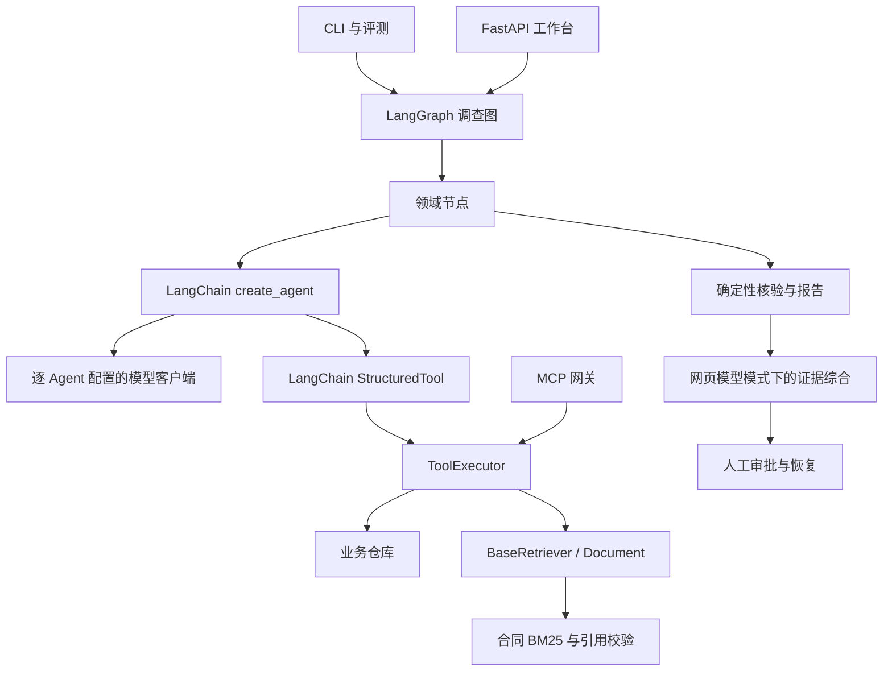

# LangChain 架构与接手指南

[ADR-007](../decisions/ADR-007-langchain-standard-components.md) 的落地由 Task 038 验证。接口文档参见 [LangChain Agents](https://docs.langchain.com/oss/python/langchain/agents)、[中间件](https://docs.langchain.com/oss/python/langchain/middleware/custom) 和 [工具](https://docs.langchain.com/oss/python/langchain/tools)。

- 调查和 Agent 的装配集中在 [investigation_demo.py](../../backend/app/investigation_demo.py)。CLI 和 Web 都使用这里的 Agent 注册及模型选择。配置 `offline` 会选定确定性实现。`ask` 是独立 Single 入口，使用同一领域内执行模块。
- [tool_loop.py](../../backend/app/runtime/tool_loop.py) 把现有模型契约适配为 `BaseChatModel`。LangChain 在模型和工具节点之间调度。中间件预留并结算共享预算，统一停止原因，标准工具将可信目标与业务权限交给执行器。报告仍使用项目原有的 Agent、工具、证据类型。
- [retriever.py](../../backend/app/rag/retriever.py) 返回标准 `Document`，保留 PDF 原业务页码、条款、版本和签署状态。注册工具在调用前解析有效文档集，BM25 在候选筛选后选 top-k，沿用现有索引的全库统计。更换检索算法时，保持授权范围、排序预期和引用契约可验证。
- [synthesis.py](../../backend/app/orchestration/synthesis.py) 用一个模型请求从已核验事实、冲突和资料缺口中选择条目，并从适用的业务建议中选择动作。严格验证索引及动作码，展示文案和金额取自验证后的报告。审批节点继续按台账规则运行。

接手时，先运行 `python -m app.cli check`，再用 `python -m app.cli investigate --model-provider scripted` 查看标准 Agent 经过工具和核验的结果。使用 `backend` 作为当前目录。安装依赖使用 `python -m pip install -e .`。

新增领域时，在 Agent 注册表声明能力、配置 YAML 和提示词。如需让调查能分派新领域，再更新规划和核验契约。新增工具时，在业务工具中声明类型、权限和输出证据，并添加到相关 YAML 白名单。Agent 工厂会通过标准工具桥接自动暴露这些声明。新增检索后端时，优先替换检索模块并用相同的引用和范围测试验证，领域 Agent 可继续调用 `document.search`。

验证入口包括 `tests.test_llm_tool_loop`、`tests.test_token_budget_gate`、`tests.test_rag` 和 `tests.test_api.TestWebModelMode`。流程变更需额外检查 LangGraph 的审批恢复与历史报告兼容性。
