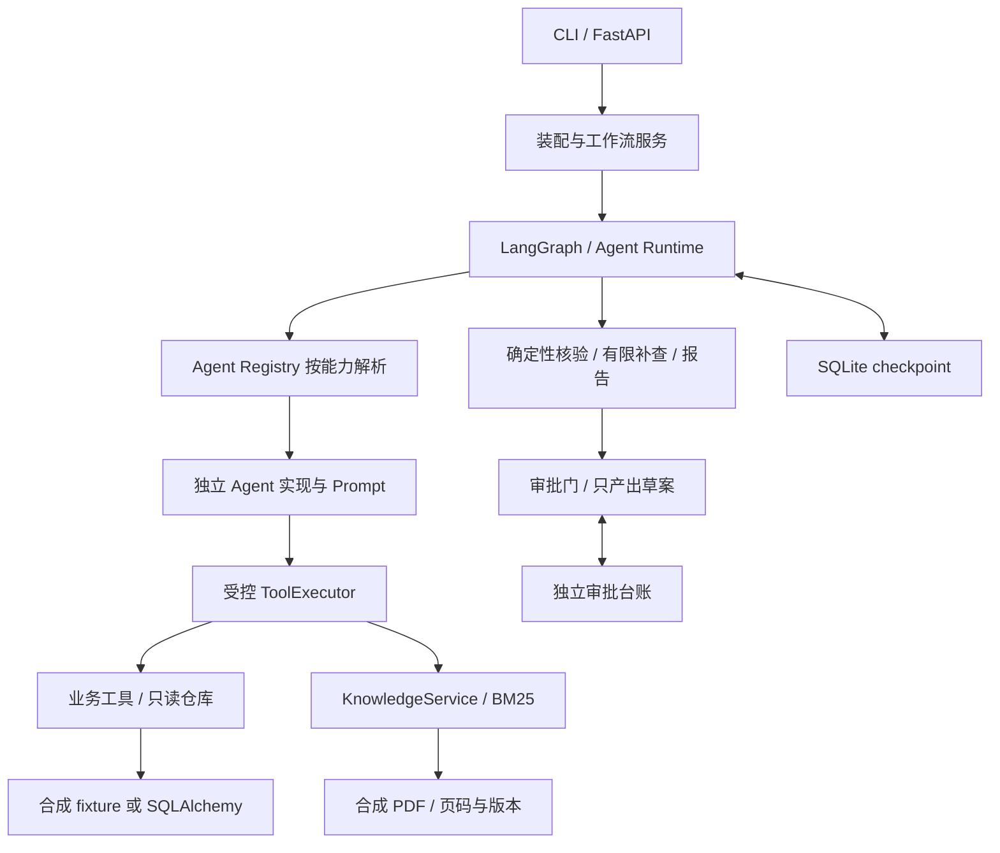

# 系统架构设计（Agent-first 当前版）

- 更新：2026-11-09，Task 026；核对代码 `d6577da`。
- 范围与优先级：[当前基线](CURRENT_BASELINE.md)、[ADR-005](../decisions/ADR-005-agent-first-refocus.md)。
- 整理前原文：[历史快照](system_design_legacy_2026-11-09.md)；历史 ADR-001～004 的原始理由仍在该快照中。

## 1. 目标和架构

用商业地产收费争议调查，展示工具调用、多 Agent 协作、状态管理、可靠性和评测。采用**模块化单体**，按接口划分模块；不建设完整地产 ERP。简单查询走短路径，复杂问题按需要调用 Lease、Billing、Property 能力。Coordinator 当前为规则规划器，并非 LLM 自由规划器。

图展示当前核心依赖；CLI 的单 Agent ask 经 AgentRuntime，investigate 经 LangGraph。两者不是所有请求都串行穿过的同一条调用链。

## 2. 代码模块与状态

| 路径（相对 backend） | 职责与实际状态 |
|---|---|
| `app/agents/base/` | 公共契约、Registry、基类、范围、事实/证据最低契约、资金结论与叙述校验 |
| `app/agents/{lease,billing,property}/` | 确定性与 LLM 实现；single 为单 Agent 基线，compliance 默认禁用 |
| `app/agents/factory.py` | 静态实现白名单、配置/类描述符一致性校验、依赖注入 |
| `app/config/` | 五个 Agent YAML 与 Schema；独立声明不代表每项均已贯穿执行路径 |
| `app/llm/`、`app/runtime/` | DeepSeek/LangChain 适配、Fake/scripted、有限工具循环、预算、可信上下文与 Trace |
| `app/tools/` | ToolRegistry / ToolExecutor；租约、账单、欠费、工单、文档搜索 |
| `app/fixtures/`、`app/db/` | 可替换只读仓库、Decimal、SQLAlchemy 映射、种子数据；迁移在 migrations |
| `app/rag/` | 合成 PDF 生成、解析分块、BM25、文档目录、两级引用核验 |
| `app/orchestration/investigation.py` | 实际 LangGraph 与 InvestigationState；state.py 保留早期通用类型，不是调查图的实际状态定义 |
| `app/orchestration/{checkpointing,approval}.py` | SQLite 持久恢复、版本绑定与串行双角色审批 |
| `app/evaluation/` | A/B/C 三基线、用例装载、scoring-v3.3、逐题与汇总报告 |
| `app/api/`、`app/cli.py` | FastAPI/同源 HTML 演示和命令行；CLI/评测不依赖 API 包 |

依赖声明在 [backend/pyproject.toml](../../backend/pyproject.toml)。Python 3.11、Pydantic、LangChain、LangGraph、SQLAlchemy、Alembic、PDF 工具、FastAPI 均已有源码使用；实际环境是否安装应以该环境检查为准。向量库、Embedding、rerank 不属于当前已实现检索链。

## 3. 模块边界

目标边界为 `入口 → 编排/Registry → Agent Protocol → 受控工具 → Business Service → Repository → Database`，KnowledgeService 作为独立工具能力接入。

现有业务工具直接使用 fixture/数据库仓库接口，部分只读业务聚合仍在仓库，尚无完整独立 Business Service 层。保留现有实现，并把职责差距显式列出；后续新增复杂业务规则或事务时应放在 Service，不继续向 Agent/Prompt 或仓库堆积。

- Agent 不持有 ORM/Session，不直接写 SQL，也不互相 import 实现。
- 编排按 capability 解析；具体 Agent 类由装配工厂登记。
- 工具调用经过执行器的白名单、权限、严格参数、预算、超时/重试、结果与范围检查及 Trace。
- 任务目标与主体授权是两个约束：有权看多个项目，不代表可以用 B-101 的事实回答 A-301。
- 业务数据与控制面分开：业务只读；checkpoint 和审批台账会正常持久化，不能把“业务只读”说成“整个程序不写磁盘”。

## 4. 数据与知识

[14 表设计](database_design.md) 是长期参考。实际 app/db/models.py 有 **12 张业务表**，当前 Lease 直接含 unit_id，没有实现旧设计的 lease_units 关联表，也未实现完整 agent_runs 业务表。具体映射以源码/迁移为据，不自动补齐 14 表。

SQLite 已有迁移/查询与 fixture 等价性测试；PostgreSQL 是目标环境，仍需实机核对驱动、迁移、隔离、精度和必要约束。旧方案中的 EXCLUDE、RLS 不因文档存在而成为已实现功能，更不要求未经范围评审全量照搬。

RAG 当前为 BM25，真实解析的是合成 PDF；页码、条款、版本与来源可以核对。合成数据与“经过真实解析”可以同时成立。混合检索按评测需要扩展。

## 5. 可靠性与交付边界

工具/模型共享预算；模型请求按物理次数计量，工具按一次逻辑调用计量并另记尝试。checkpoint 使用本机 SQLite；一条 thread 只承载一次新调查，恢复走现有恢复入口。审批只产出 approved_draft_only，业务副作用为空。

最新代码问题 Z1–Z3、独立模型配置、真实评测、人工量表与 PostgreSQL 实机均未因本文更新而完成。细节见 [当前基线](CURRENT_BASELINE.md)、[运行时契约](agent_runtime_contracts.md) 与 [进度表](../product/PROJECT_DEVELOPMENT_ROADMAP.md)。部署、分布式化和 MCP 属后续可选扩展。
