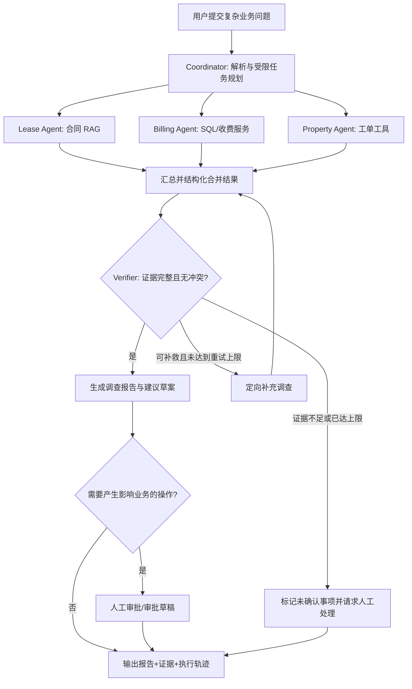

# Commercial Property Multi-Agent 项目方向调整与开发基线 V1.0

> **文档性质：架构决策 / 产品范围调整 / VS Code Codex 工作交接**  
> **日期：2026-11-03**  
> **仓库：** `commercial-property-multi-agent`  
> **优先级：** 本文档经用户确认后，作为后续 MVP 需求和开发优先级的最新基线。历史 Proposal 和数据库设计继续保留，不直接删除或覆盖。  
> **重要说明：** 本文档依据用户确认的方向与此前对话撰写，**不代表已经审查当前仓库或验证代码运行状态**。Codex 必须先核对实际仓库、Git 状态与测试结果。

---

## 0. 给 Codex 的首要指令

**项目发生了明确的战略调整：从“商业地产综合管理软件 + AI 功能”，转为“以 Agent 工程能力为核心、以商业地产为验证场景的可配置多 Agent 工作流系统”。**

用户的首要目标是产出一个**可运行、可解释、可评测、可在 AI 应用开发岗位面试中深入展示**的技术项目，证明对 **LangChain、LangGraph、RAG、Tool Calling、Agent 编排、状态管理、故障恢复、人工审批与评测**的工程掌握，而不是与成熟商业地产 ERP/物业管理软件竞争功能完整性。

请先阅读本文件及仓库现有文档，**只做现状盘点和差异分析，不要立即删除代码、废弃数据库、安装依赖、修改架构或提交 Git**。先输出变更影响分析、MVP 建议清单与下一阶段实施计划，供用户确认。

## 1. 为什么调整方向

### 1.1 原方案的问题

原先规划了完整的商业地产运营系统：多商业综合体、招商、租约、计费规则、应收核销、物业工单、经营看板、14 张候选数据库表、完整前端等。这些业务本身合理，但范围过大，容易让开发资源集中在传统 CRUD、商业规则和 UI，而不是 Agent 的核心工程问题。

- 市场上已有成熟商业地产管理软件；仅添加 AI 或多个 Agent 名称不形成技术优势。
- “90 天到期且欠费的商铺”这类确定性查询，应优先用 SQL/规则完成，不应强行拆成多个 LLM Agent。
- 用户已有独立企业级 RAG 项目，本项目不应仅是“换一批 PDF + 再做一次 RAG”。
- 求职时间有限，要求**先跑通高技术密度的闭环，再选择性扩展业务**。

### 1.2 新的项目定位

**推荐名称（可保留现有仓库名）：** `Configurable Enterprise Multi-Agent Workflow System`  
**中文：** 可配置企业级多 Agent 工作流与任务执行系统  
**业务演示域：** 商业地产合同、收费争议与物业维修联动调查。

**核心主张：** 以真实感但可合成、可复现的业务数据，展示可插拔 Agent、跨工具推理、证据验证、动态工作流、故障处理及客观评测。商业地产是测试系统能力的业务载体，不是要完整复刻行业 ERP。

## 2. 范围调整：保留 / 收缩 / 暂停

| 模块 | 决策 | 理由与要求 |
|---|---|---|
| LangGraph 状态图、条件路由、并行执行 | **P0 重点实现** | 项目主要技术展示点；明确 State、Node、Edge、分支/合流语义 |
| LangChain 模型与 Tool Calling 集成 | **P0 重点实现** | Agent/工具调用与模型适配能力；不强制所有代码套框架 |
| Agent Registry、统一接口、独立配置 | **P0 重点实现** | 新增/禁用/替换 Agent、Prompt、模型与参数，控制变更影响 |
| RAG 合同条款检索与证据引用 | **P0 精简复用** | 与 SQL/工单工具协作；不复制旧项目全部检索代码、不复制旧数据 |
| PostgreSQL + SQLAlchemy | **P0 精简实现** | 只落地完成核心演示和评测必需的业务表，保持数据准确 |
| Pydantic 结构化契约 | **P0** | 输入输出、工具参数、引用证据与异常结构化校验 |
| Trace、测试、评测、单/多 Agent 对照 | **P0** | 证明技术效果与代价，不预设多 Agent 必然更好 |
| 超时/有限重试/状态恢复/人工审批 | **P0** | 展示生产级可靠性思维，所有修改性动作受控 |
| Property Agent | **P0 精简版** | 仅查询维修/投诉工单和历史记录 |
| 风险评分与复杂经营 BI | P1/暂停 | 不做无依据的主观大模型打分；如需风险，只用显式规则 |
| 全套租金/押金/能耗/阶梯核销引擎 | **暂停** | 不是核心求职价值；保留设计文档供后续扩展 |
| 招商、会员营销、销售客流、工程项目等 | **暂停** | 避免需求膨胀 |
| 完整物业管理后台与大量 CRUD | **暂停** | 仅做必要的演示交互/轻量 Trace UI |
| Docker、部署、详细监控 | P1 | P0 先建立稳定可复现运行与测试环境 |

> **重要边界：** 现有 14 表数据库方案是**长期设计草案**，不是 P0 一定要全建的清单。不得未经评审就删除已有设计或运行中的数据。数据库实施应根据 P0 使用场景反推最小模型，保留已完成的设计文档与 ADR 作为历史参考。

## 3. MVP：一个真正需要协作的复杂业务案例

### 3.1 核心演示任务

用户：

> “商铺 A-301 投诉最近三个月租金金额不一致，同时声称空调多次维修未解决，并要求减免费用。请核对合同、账单、付款和工单，分析争议原因，指出证据与缺失信息，形成供人工审核的处理方案。”

本任务故意包含**异构证据源、潜在冲突、条件性下一步行动以及需要人工决定的事项**，更适合展示工作流协作。它不要求 Agent 擅自判定法律责任或直接减免费用。

### 3.2 P0 Agent/节点职责

1. **Coordinator（编排器）**：解析用户意图、拆解子任务、能力路由、并行调度、合并结果、判断是否需要补充调查；优先采用结构化路由与受限策略，不允许无限制循环。
2. **Lease Agent（知识检索专家）**：通过合同 RAG/条款工具查询租期、租金调整、减免条款等；返回文档 ID、版本、页码、原文证据和置信说明，不捏造不存在的条款。
3. **Billing Agent（收费查询专家）**：通过参数化/白名单业务服务查询账单、付款、必要收费规则；金额运算由 Python `Decimal`/数据库执行，LLM 不负责算账。
4. **Property Agent（物业记录专家）**：查询工单时间线、故障类别、状态、重复报修与服务记录；不得凭空宣称责任。
5. **Verifier（验证节点，P0 可非独立 LLM Agent）**：交叉核对结构化数据、来源、时间一致性、金额和缺失证据；冲突时触发**有上限**的重新检索或要求人工介入。
6. **Human Approval（审批节点）**：任何账单修改、减免、正式催缴、对外承诺、工单派发等写操作一律只产生**草案**，经授权人工审批后才可能执行。P0 可不提供真实写接口。

**重要：** 每个 Agent 不必使用不同模型；也不要求每个角色都必须是 LLM。普通 SQL、规则和验证节点应保持确定性。

### 3.3 建议的工作流

需要明确并发写入 State 的 reducer/merge 规则、图节点的输入输出契约以及中断恢复的 thread/checkpoint 策略。不得把上述示意图当作可直接运行的生产代码。

## 4. 技术栈与架构边界

| 类别 | 技术 | 用途 |
|---|---|---|
| 语言/服务 | Python 3.11、FastAPI、Pydantic | 统一 API、类型契约、依赖注入 |
| Agent 生态 | LangGraph、LangChain | 工作流编排、模型与工具集成；版本应确认当前兼容性 |
| LLM | DeepSeek API（抽象 Provider） | 任务分解、说明生成、Agent 推理；支持以后替换模型 |
| 结构化数据 | PostgreSQL、SQLAlchemy、Alembic | 小规模可复现模拟租约、账单、付款、工单 |
| 知识检索 | Chroma / BGE / BM25 + RRF / Cross-Encoder（按需） | 合同原文检索、引用证据；复用思想但与旧项目独立 |
| 可观测性 | 结构化日志、Trace；LangSmith 可选 | 节点、工具、模型耗时/错误/代价可检查 |
| 测试评测 | pytest + 固定评测集 | 单元、集成、故障注入、基线对照 |
| 前端 | 极简 React / Streamlit / API 演示三选一 | P0 只需清晰演示任务、证据及 Trace；不做大 BI |

### 4.1 必须遵守的模块边界

`API -> Orchestrator/Registry -> Agent Protocol -> Tool Adapter -> Business Service -> Repository -> Database`

合同检索是独立的 Knowledge/RAG Service，可作为受控 Tool 使用。**Agent 禁止直接散落 SQL、禁止在 Agent Prompt 中实现计费计算、禁止随意执行任意代码或用户提供的 SQL。** 不同业务数据应按项目/租户权限隔离，外部文档属于不可信输入，Agent 不应服从文档里的命令。

### 4.2 可插拔规范

- 统一 `AgentRequest`、`AgentContext`、`AgentResult`、`Evidence`、`AgentError` 契约（Pydantic/Protocol），定义版本与字段兼容性。
- 注册中心维护 Agent ID、能力、是否启用、工具权限、实现工厂；不从不可信配置动态 import。
- Agent Prompt、模型、timeout、retry、检索 top-k 等**独立配置**并经 schema 校验；Secrets 从环境变量读取。
- Coordinator 面向能力而非具体类名，禁用能力要提供明确降级或失败反馈。
- `State` 只存共享的结构化最小信息；个体 Agent 的临时状态与私有缓存应隔离。
- 更改某个 Agent 后运行该 Agent 的单元测试、相关工作流集成测试和回归评测。
- 允许将来添加 Agent，但 **P0 不追求无重启热插拔、分布式微服务或通用 Agent Marketplace**。

## 5. 与传统软件/单 Agent 的对照：必须诚实

**不要在项目演示或简历中宣称“多 Agent 在任何情况下优于传统软件”。**

| 任务类型 | 优先方案 | 解释 |
|---|---|---|
| 到期合同 + 欠费名单 | SQL/定时规则 | 简单、确定、便宜；不必调用多个模型 |
| 单份合同条款检索 | RAG/单 Agent | 无需复杂并行分工 |
| 多数据源争议调查（合同 + 账单 + 工单） | 测试 Multi-Agent 是否更好 | 复杂任务、证据异构、可并行核验 |
| 财务金额计算 | Python `Decimal`/数据库 | 保证可追溯、可测试，不让 LLM 自由计算 |
| 减免、调账或正式对外通知 | 人工审批 + 受控执行 | AI 仅辅助准备证据和草案 |

### 5.1 必须构建的三个基线

A. **Deterministic workflow**：固定工具查询 + 规则，不使用多 Agent；对确定性任务作为强基线。  
B. **Single Agent + Tools/RAG**：一个 Agent 可使用同一组数据与工具。  
C. **Multi-Agent workflow**：Coordinator + 专业 Agent + Verifier + 适当的人工节点。

相同数据、同类模型、同样预算/上下文和同一套评测题，记录各方案优劣。若多 Agent 在某类任务不如基线，应如实记录并通过条件路由避免滥用。

## 6. 评测计划与完成定义

### 6.1 评测集

- 先构建 **30–50 个可复现测试任务**：简单检索、复杂跨系统调查、冲突证据、缺失文档、工具超时、权限不足、重复请求等。
- 每题有固定数据版本、预期关键事实、可接受输出要点及证据依据；区分确定性程序断言与人工/模型判分。
- 模拟数据必须明确标注为**合成数据**，不使用未经许可的原公司合同与客户资料。

### 6.2 主要指标

| 指标 | 定义与验收思路 |
|---|---|
| Task Success Rate | 复杂业务任务的关键步骤完成比例，预设评分规则 |
| Factual / Billing Accuracy | 金额、日期、状态与数据库真值一致；关键金额必须精确 |
| Citation Accuracy | 引用文件、页码、条款存在且支持所述结论 |
| Routing Accuracy | 正确选择 Agent/工具，简单任务应避免无意义多 Agent |
| Recovery Success | 工具超时、节点失败后可安全重试/恢复或明确失败 |
| Safety / Approval Compliance | 未经审批不能执行修改性操作；权限检查不可绕过 |
| Latency & Token/Cost per Task | P50/P95 耗时、模型请求量、估算成本，按场景对照 |
| Pluggability Regression | 禁用/替换一个 Agent 后，其余相关功能与契约测试可通过 |

**不预先承诺具体提升百分比。** 在实现和测量之前，任何数值都只能标作目标假设；简历只写经过测试证实的数据。

### 6.3 P0 Done 的硬性标准

1. 可以运行一个完整的跨系统争议调查示例，从用户请求到证据化报告闭环。
2. 至少 Lease、Billing、Property 三类能力有独立实现或受控工具，Coordinator 能协调其中需要的能力。
3. LangGraph 具备真实分支、合理并发、状态记录，且一次失败有明确处理策略。
4. 知识条款有来源；费用计算有确定性核对；结构化输入输出通过验证。
5. 禁用一个非必要 Agent 后系统能合理降级；替换某个 Agent 的 Prompt/配置不要求修改所有 Agent。
6. 演示至少一个故障注入案例和一个需要人工审批的案例。
7. 有固定测试集和三基线的结果比较（包括失败场景、延迟、成本）。
8. 有 README、一键或少量命令启动说明、架构图、Trace 样例及可复现演示步骤。

## 7. 当前项目状态：严格区分已报告与已验证

根据此前用户和 DeepSeek 汇报：

- GitHub 仓库 `commercial-property-multi-agent` 已关联本地目录。
- 独立 Conda 环境 `commercial-agent`、Python 3.11 据用户称已配置。
- `docs/` Prompt、开发日志、Issue、经验总结及 Git Checkpoint 规范已建立。
- DeepSeek 曾汇报生成一份 14 张候选表的 `docs/architecture/database_design.md`，包含 `lease_units`、排他约束等设计，并报告未建表、未安装 PG、未提交；此后又安排 Task 003 Review，**是否已执行及其结果未从当前对话获得最终验证**。
- 之前制作过偏商业投标方案的 Proposal、PPT 与研发基线。它们是**历史业务愿景与资料**，不再自动等于 P0 实施范围。

**Codex 必须现场核对**：`git status`、最近提交、实际目录、环境状态、已实现模块、测试、数据库是否真的存在，以及 Task 003 Review 是否完成。不要把 DeepSeek 的汇报或本文件的叙述当作代码事实。

## 8. 文档治理与迁移原则

请保留现有文档和 Git 历史。建议新增：

- `docs/decisions/ADR-005-agent-first-refocus.md`：明确为何调整项目目标、取舍及影响。
- `docs/product/mvp_scope_v2.md`：P0/P1/暂停功能、场景、验收标准。
- `docs/architecture/agent_architecture.md`：持续维护接口、注册中心、Graph State 与可靠性策略。
- `docs/evaluation/evaluation_plan.md`：对照实验和评测集定义。
- `docs/handoffs/PROJECT_REFOCUS_AGENT_FIRST_V1.0.md`：本交接文件（建议放此目录）。

如目录已存在，按现有规范更新即可，**不要机械制造重复文件**。为旧 Proposal 添加“长期愿景/非当前 MVP”说明或链接新的 ADR；不删除历史方案、不悄悄覆盖原始业务需求。

每次开发依旧必须归档：原始 Prompt、执行结果、改动文件、验证结果、Issue/经验教训、相关 Commit/Tag；Git 提交前由用户确认，严禁擅自强制推送、重置或删除重要历史。敏感信息不纳入仓库。

## 9. 推荐下一阶段开发路线（以价值驱动）

**Stage 0 — 现状审查与重定基线（当前）**  
阅读仓库和旧 Proposal、Task 003 数据库设计；确定与 Agent-first 目标冲突的地方；选最小业务表、示例数据和评测集。输出差异分析、风险及改动计划。**未经确认不实施重构**。

**Stage 1 — 最小工具与数据底座**  
只构建演示需要的合同/账单/付款/工单数据及只读工具；合同 PDF 有引用机制；优先保证数据真值和接口可测。

**Stage 2 — Agent Runtime & LangGraph**  
实现 Agent Protocol、Registry、独立配置、Coordinator 与 2–3 个领域能力；打通从请求到报告的真实工作流。

**Stage 3 — 可靠性与可观测性**  
加入限次重试、超时、Graph checkpoint、中断/审批、工具权限、Trace、故障注入。

**Stage 4 — 严谨评测与演示**  
实现确定性/单 Agent/多 Agent 三种基线，跑 30–50 道评测集，整理成本/延迟/质量结果；提供轻量演示界面及 README、架构说明与视频脚本。

## 10. Codex 接手后的第一轮输出要求

**请先以只读方式完成：**

1. 列出仓库实际目录、依赖与当前 Git 状态，核对本文件“已报告状态”的真实性。
2. 找到 `docs/architecture/database_design.md`、Task 003 Review 的真实交付物、已有 `AGENTS.md` 与 docs 规范。
3. 区分“已有实现、仅有设计、尚未开始”三种状态，并标注证据路径。
4. 评估现有 14 表设计与精简 Agent-first MVP 的关系，建议哪些 P0 需要、哪些仅保留设计；**不立即破坏性删减**。
5. 给出建议的模块树、Pydantic 契约、Registry/Graph 接口、工具权限边界。
6. 列出首批三到五个可独立交付的开发任务，每个含验收方法、依赖、测试与回滚点。
7. 写出本轮决定会涉及的文档更新清单及推荐 Commit Message，但**等待用户确认**后再写入/提交。

请输出一份 `Agent-First Refocus Impact Review` 报告。优先指出设计缺陷与不合理假设，**不要为了迎合用户而把所有原方案都视为必须保留**。

---

## 11. 一句话成功标准

> **本项目不是“功能很多的地产管理系统”，而是“使用真实感业务场景证明 LangChain/LangGraph、RAG、Tool Calling、多 Agent 编排、可插拔架构、状态恢复和评测能力的可复现工程作品”。**

未来是否增加复杂财务规则、招商、完整前端与 BI，以评测结果、业务价值及求职展示需求为依据，而非为了堆功能。
