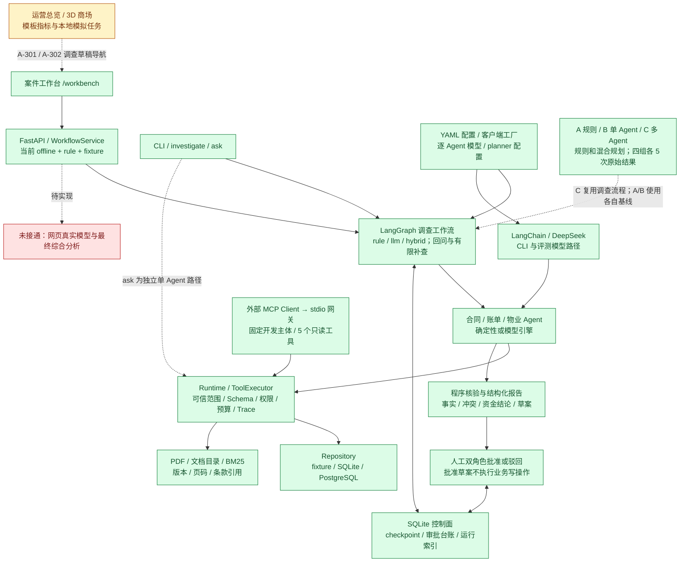
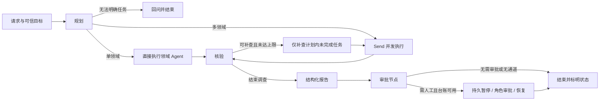

# 当前项目架构复查（Task 036）

- 日期：2026-11-24（Asia/Shanghai）。
- 范围：当前源码、入口装配、Git、032–035 交付记录、正式评测原始报告、未提交界面及离线回归；不是重新执行全部安全审计或 PostgreSQL 实机验收。
- 基线：main / 77410ca；本地缓存 origin/main 同 hash，未联网 fetch，不能据此保证远端此刻状态。
- 审查开始已有 9 个已跟踪文件修改，以及 `.claude/`、static/mall、static/ops 未跟踪文件；均保留。源码、测试和 README 的已有改动不是本轮审查编写。
- 结论：模块化单体已具备模型驱动领域 Agent、逐 Agent 模型配置、LLM/hybrid 规划、受控工具、BM25 RAG、持久审批、stdio MCP、PG 数据层和重复真实评测；网页主链路仍默认 offline + rule，运营总览另有浏览器侧模拟流程，不能合并宣称完整 AI 运营系统已完成。

## 1. 实际系统组成

绿色表示源码中存在并有相应入口；黄色表示模拟或有限范围；红色表示缺口。绿色不等于生产验收。以下包含当前未提交页面，不能仅由 HEAD 复现。

边界补充：PG 在 CLI 的专门装配层接入；build_investigation_bundle 原生仅 fixture/sqlite，CLI 当前通过临时替换 SQLite 仓库工厂注入 PG。MCP 是工具网关，不会自动触发完整调查工作流。评测 B 是单 Agent，不经过 C 的整张图。SQLite 控制面不是 PG 业务数据库。

## 2. 实际调查工作流

当前 Supervisor 主要选择领域与回问；不是开放式任意创建 Agent 的自治调度。规划失败、非法输出、超时和预算不足有可审计回退。报告节点主要是程序汇总、确定性核验，不是新增的最终综合分析 LLM。

## 3. 与上次状态的差异

| 能力 | 当前核实 |
|---|---|
| 逐 Agent 模型 | _deepseek_clients 按每份 YAML 创建，缓存仅共享同参数客户端；不能再写“全部只读 single.yaml” |
| 规划 | supervisor.py 已有 rule/llm/hybrid；当前 planner.yaml 默认 rule，模型路由与领域模型可分开 |
| MCP | stdio 网关已存在；ToolExecutor 唯一执行入口，连接级身份/预算，5 个只读工具；HTTP/OAuth/Flowise 实连仍未完成 |
| PostgreSQL | 迁移/seed/只读会话/精度/约束/只读角色/CLI 入口有源码与既有实机证据；本轮未连接或重跑 PG，不能宣称本轮实机通过 |
| 真实评测 | formal_20261123 下有 20 份组报告，rep1–5；已有四组重复测量，不能继续写“没有开展正式真实对照” |
| 前端 | 工作区新增运营总览和 3D 商场，原工作台改为 /workbench；当前包含未提交改动 |

## 4. 架构问题与风险

### A1：网页仍未接通真实模型与 PG 装配，是主要产品缺口

`app/api/service.py:367` 提交调用未传 model_provider/planner_mode/backend；bundle 默认 offline/fixture，planner.yaml 当前 rule。RunRequest 也没有对应模式字段。CLI 支持模型或 PG，不能据此说网页已接通。

缺口影响：用户在页面看不到真正的模型调查分析；有 Key 不会自动切换。应由服务端可信配置明确选择引擎、模型与数据源，返回实际模式/用量，并补模型领域回答与最终证据综合。不能由前端伪造模式，也不应任由不可信请求提供身份或数据库 URL。

### A2：新运营总览与真实后端存在两套互不等价的业务状态

`static/ops/app.js:39` 的 6 类 Agent、`:102` 的指标与场景模板为前端定义；任务存 localStorage（:112、:260），审批/完成只改本地 task.status（:366），表单只向本地 tasks 数组加对象（:427）。未调用真实调查/审批 API。mall 组件可给 A-301/A-302 生成 /workbench?store=... 导航，这只是草稿入口，需用户提交后才运行调查。

页面有“演示环境”“模拟数据”和部分“模拟回执”标识，README 也有披露，因此不是断言整个页面完全没有说明；但“6 个 Agent 在线”“已接单”“执行回执”等具体措辞容易被误读成运行事实。后台真实领域是合同/账单/物业，加 Single，Compliance 默认禁用；新客流/营销/商户/设施/安保/调度不能算新后台 Agent 已实现。

建议明确产品边界：模拟任务动作逐处标注，保持与真实案件独立；若希望产品化，则为真实任务统一 run_id、后端状态、审批及审计，不能用本地演示审批替代原双角色审批。

### A3：真实评测已跑完，质量结论尚未完成审计

summary.md 的 scoring-v3.3 原始均值：A 66.7%、B 35.3%、C_rule 56.0%、C_hybrid 52.0%。以上是保存的评分结果，不是本轮新调用模型所得，也不能直接当真实准确率排名。

最新 11-23 交接明确指出资金字段评分误判、拒绝状态口径不一致，以及 H11/H16 的跨主体失败待核查。**本轮未逐题独立复现这些原因，不能把待核查项当作已证实越权泄漏，也不能默认都是评分错误。** 应先审计安全题和评分器，必要时新版本离线重算，保留 v3.3 原始结果。人工评分尚未完成；已曝光 heldout 只能支持回归/探索性结论。

### A4：数据库装配仍有耦合，不能直接推广到并发 Web 服务

`cli.py:893` 的 _postgres_repository_seam 临时修改 bootstrap.build_sqlite_repository，结束后恢复；已有仓库身份断言防静默回退。CLI 单次运行有保护，但全局替换不是适合多请求并发的依赖注入方式。

建议为装配函数显式提供 repository 或 repository_factory，并在入口管理连接生命周期。RLS、并发、多实例、生产身份与部署属于未验边界，不由单机成功测试推导。

### A5：当前文档已落后于实际提交与测量

README/当前基线仍有“PG 或正式对照未做”“待提交/待确认”等残留，与 Git 和正式原始结果并存。11-23 交接已主动披露该归档缺口。新未提交的 ops 改造也还没纳入既有正式任务记录。

本轮只另建当前审查和归档，未改写冻结评测、旧报告、原始 Prompt 或大规模重写当前规范。建议下一轮明确同步正式实验状态，区分“原始运行完成”与“质量审计完成”。

## 5. 本轮实际验证与限制

- 默认环境全量：项目 Python 执行 unittest discover，**719 tests，43.642 秒，OK（skipped=45）**；44 项为未配置 PG 测试环境的 PG 用例，另 1 项既有跳过，不能当作 719 项全部实跑成功。
- 契约自检：**70 项通过**。
- Git diff --check 通过；原工作区 9 个源码/README/测试修改与 mall/ops 未跟踪成果均保留。
- 阅读实际 API/工作流/模型配置/MCP/PG 装配和 formal 原始汇总；核对 20 份报告及 5 次重复目录。
- 未调用真实模型，未连接/重建数据库，未审批用户既有任务，未浏览器人工验收或生成新截图，未启动/停止服务。
- 未执行 Git 提交/推送；未运行自动编码循环或另一个模型。交接中的其他模型复查仍归其历史来源，不算 Codex 本轮独立重验。

## 6. 下一步建议

1. 核清模拟运营总览与真实工作台的边界，保证演示陈述准确。
2. 审计已保存真实评测的评分和安全失败，不新增模型调用即可先推进；同步任务/基线/路线图中的实验状态。
3. 重构入口装配后让网页通过明确服务端配置接通实际模型，补领域分析与最终综合报告；审批和金额规则保持确定性边界。
4. 最后完成 PG 最后一轮条件复核、人工量表和最终环境复现；再决定发布。

全局 036 本轮用于当前架构审查；交接曾建议但尚未登记的正式评测归档应另分配后续编号，不伪造其原始 Prompt 或已完成审计。
